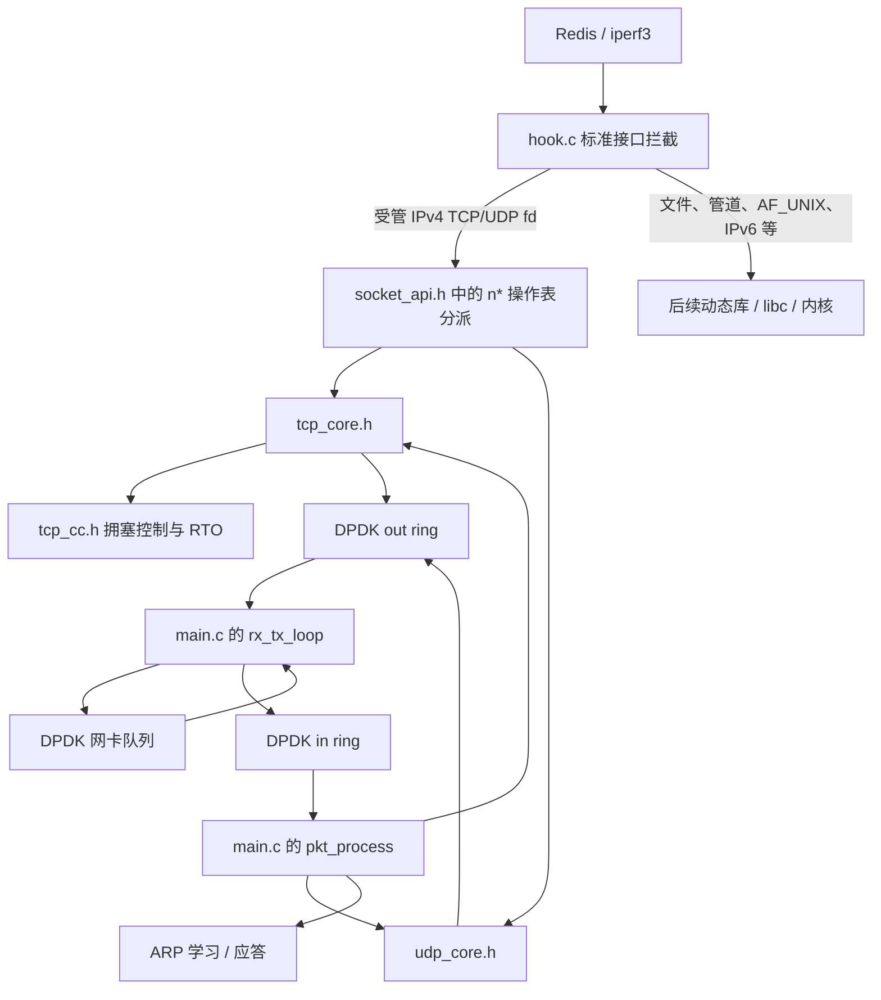

# 13_redis 代码导读：文件结构与 hook.c 全函数说明

更新日期：2026-10-29。本文对照当前源码整理，面向第一次重新阅读这个目录的人。本文只解释结构，没有修改协议栈行为。

建议先读第 1～5 节建立整体认识，再查第 8 节的 hook 函数。阅读实际源码目录，不要把 `build/format-before/` 或 `build/headers-format-before/` 中的历史备份当成正在编译的代码。

本版 epoll 已独立为 [epoll_core.c](../epoll_core.c)，设计与限制见 [EPOLL.md](EPOLL.md)。

## 1. 先记住这一条主线

这个目录编译的不是一个 Redis 程序，也不是一个带 main() 的独立网络服务器，而是可加载到 Redis、iperf3 等程序中的共享库：

```text
应用调用 libc 风格的 socket/read/write/epoll 等接口
    ↓ LD_PRELOAD 使应用先进入我们的同名函数
hook.c：判断 fd 归属，适配接口和事件等待
    ↓ n* 函数
socket_api.h：通过静态协议表和操作表分派 n* 接口
socket_core.h：公共 fd 管理、锁与共享辅助函数
main.c：组织初始化与数据面
    ↓
tcp_core.h：TCP 状态机、字节流、窗口、重传
udp_core.h：UDP endpoint、数据报队列、收发
    ↓
DPDK 软件 ring → 网卡 TX 队列 → 对端
```

收包反向进行：网卡 RX 队列 → DPDK in ring → 协议解析 → socket 接收缓冲 → 应用读取。

**hook.c 负责“这个调用交给谁”；TCP/UDP 核心负责“协议怎么运行”；main.c 负责“如何把这些部分组织起来并连接到网卡”。**



AF_PACKET 测试中，底层以太网通道仍使用内核提供的设施；被接管 socket 的 TCP/UDP 协议处理在本库中。真实内核 eventfd 也只是占用 fd 编号，不能据此认为网络数据经过了内核 TCP/UDP socket。

## 2. 文件地图

### 2.1 实际代码与构建文件

| 文件 | 职责 | 第一次阅读时关注什么 |
| --- | --- | --- |
| [Makefile](../Makefile) | 把 main.c、hook.c、epoll_core.c 编译成 build/libdpdknet.so；提供 make test | SRCS、HDRS、共享库目标、test 目标 |
| [hook.c](../hook.c) | 重定义标准 socket/I/O/事件函数，分流到协议栈或 libc，处理 fork 与退出 | socket、managed、REAL、epoll_wait |
| [net.h](../net.h) | hook 和协议栈之间的声明接口 | n* API、生命周期、fd 查询函数 |
| [main.c](../main.c) | EAL 与网卡初始化、两个数据面线程、ARP 收发、报文分发；也混有旧教学代码 | netstack_init、pkt_process、rx_tx_loop |
| [socket_core.h](../socket_core.h) | 公共 fd 类型登记、分配释放、共享锁、时钟/地址等辅助函数 | socket_fd_kind、socket_fd_alloc、socket_state_lock |
| [socket_api.h](../socket_api.h) | 静态协议注册、操作表、统一 n* 分派及消息适配 | socket_protocols、socket_ops、nsocket、nsendmsg |
| [tcp_core.h](../tcp_core.h) | TCP 控制块、连接状态机、发送队列、接收字节缓冲、定时处理、TCP API | ng_tcp_stream、tcp_send/recv、ng_tcp_process/out |
| [tcp_cc.h](../tcp_cc.h) | TCP 序号比较、Reno、RTT/RTO 算术 | tcp_cc_ack、tcp_cc_dupack、tcp_cc_timeout |
| [udp_core.h](../udp_core.h) | UDP socket、数据报队列、默认对端、报文收发和 UDP API | udp_datagram、udp_sendto/recvfrom、ng_udp_process/out |
| [arp.h](../arp.h) | ARP 表结构、链表宏、查 MAC 辅助函数 | arp_table_instance、ng_get_dst_macaddr、LL_ADD/LL_REMOVE |
| [nty_tree.h](../nty_tree.h) | SPLAY/红黑树宏，供 epoll_core.c 的订阅树使用 | 先理解 RB_FIND/RB_INSERT/RB_REMOVE 的用途 |
| [epoll_core.c](../epoll_core.c) / [epoll_core.h](../epoll_core.h) | 自己的 epoll：实例表、红黑树、FIFO 就绪队列、主动唤醒与等待 | nepoll_create1、nepoll_ctl、wait_events、nepoll_notify |
| [.clang-format](../.clang-format) | 当前目录的 C 排版配置 | 与运行逻辑无关 |

### 2.2 为什么 .h 里面有完整函数？

通常头文件只放声明，但这里的 tcp_core.h、udp_core.h 是**内部实现头文件**，main.c 中按如下顺序包含：

```c
#include "tcp_core.h"
#include "udp_core.h"
#include "socket_api.h"
```

Makefile 真正编译的源文件只有：

```make
SRCS := main.c hook.c epoll_core.c
```

因此，TCP/UDP 核心的函数会随着 main.c 一起编译，不需要再把这些头文件单独传给编译器。hook.c 包含 net.h 和 epoll_core.h，通过 n* 与 nepoll_* 接口访问协议栈和自己的事件实现。

两种协议都通过 socket_core.h 使用公共设施，不再依赖对方的实现；test_socket_api.c 特意先包含 UDP 再包含 TCP 验证这一点。socket_api.h 在两种协议之后包含，用于装配操作表。实现头文件仍只属于一个编译单元，不应重复编译或在多个生产编译单元中包含。具体设计见 [SOCKET_ARCHITECTURE.md](SOCKET_ARCHITECTURE.md)。

### 2.3 测试目录

| 文件 | 测试对象 |
| --- | --- |
| tests/test_tcp_cc.c | 序号回绕、慢启动、拥塞避免、快速恢复、RTO 退避 |
| tests/test_tcp_core.c | 编译实际 TCP 核心，模拟报文与时钟，验证握手、窗口、重传、收发、关闭和关闭后立即重绑定 |
| tests/test_socket_api.c | 编译实际统一 API 和两种协议，验证分派、消息、fd 复用、accept 登记和 fork 清理 |
| tests/test_udp_core.c | 编译实际 UDP 核心，验证数据报边界、校验和、peek/trunc、队列与超时 |
| tests/packet_test_support.h | 上述报文测试使用的模拟 mbuf、ring、时钟和系统接口；不是生产 DPDK 实现 |
| tests/test_epoll_core.c | 直接测试自己的 epoll 核心、主动唤醒、信号和关闭；支持内存检查 |
| tests/test_hook.c | 用真实 Linux fd 检查 hook 的 libc 回退、混合事件、fork 等行为 |
| tests/hook_backend.c | test_hook 的假协议栈后端；只用于测试，不是应用实际使用的协议栈 |
| tests/test_udp_api.c | 真正加载 libdpdknet.so 检查 UDP API，断言 nisdgram(fd) 成立 |
| tests/udp_peer.py | UDP API 联调的独立内核对端 |
| tests/redis_stream.py | Redis 二进制大数据、流水线、并发和 BGSAVE 联调 |
| tests/smoke_linux.sh | 用临时 veth/network namespace 和 DPDK AF_PACKET 跑应用联调，含同一 iperf3 服务端进程连续测试 |

make test 运行拥塞控制、TCP 核心、UDP 核心、统一 socket API、epoll 核心和 hook 六组测试。真实应用联调另运行 smoke_linux.sh。

### 2.4 文档与 build 目录

所有维护中的 Markdown 文档统一放在 docs/；入口为 [文档索引](README.md)。

| 路径（相对于 13_redis） | 用途 |
| --- | --- |
| docs/CODE_GUIDE.md | 文件结构与 hook 全函数导读 |
| docs/BUILD.md | 构建、运行命令与排错 |
| docs/PROTOCOLS.md | TCP/UDP 语义、窗口、拥塞控制、定时处理与限制 |
| docs/EPOLL.md | 自己的 epoll 的订阅、队列、唤醒和锁 |
| docs/VALIDATION.md | 实测环境、测试范围、结果和日志 |
| build/libdpdknet.so | 应用实际加载的协议栈共享库 |
| build/libhook_test.so | hook 测试使用的假后端库 |
| build/*test*、build/*log | 测试二进制和原始日志 |
| build/format-before/、build/headers-format-before/ | 历史源码备份，不参与构建 |
| build/format-tools/、build/iperf-tools/ | 测试时解包的工具和依赖 |

## 3. 程序从哪里开始，哪些线程在工作？

### 3.1 加载 so 不等于立即启动 DPDK

启动应用时：

```bash
LD_PRELOAD=/绝对路径/libdpdknet.so redis-server ...
```

动态加载器加载共享库，执行 hook_register_fork()，它只注册 fork 回调。首次符合接管条件的 socket() 才会调用 netstack_init()。

```text
应用第一次创建 IPv4 TCP/UDP socket
    → hook.c: socket()
    → main.c: netstack_init()
    → pthread_once(..., netstack_init_once)
    → 读取 DPDKNET_IP、DPDKNET_EAL_ARGS
    → EAL、mbuf pool、网卡 RX/TX 队列、MAC、软件 rings
    → 创建两个后台 pthread
    → nsocket() 创建应用的 TCP/UDP 控制对象
```

netstack_init() 可以被重复调用；pthread_once 保证初始化主体只执行一次。它不是允许失败后随意重新初始化的接口。

### 3.2 两个自建数据面线程

| 执行方 | 负责的工作 |
| --- | --- |
| 应用线程 | Redis/iperf3 自己的业务和事件循环，经 hook 调用 n* API |
| rx_tx_loop | 从网卡 RX 批量取 mbuf 放入 in ring；从 out ring 取 mbuf 交给网卡 TX |
| pkt_process_thread → pkt_process | 从 in ring 取包，处理 ARP/TCP/UDP；调用 ng_tcp_out、ng_udp_out 发送队列中的数据 |

EAL 还可能创建自己的内部线程，不要把整个进程理解为只有三个线程。

两种缓冲不是同一个东西：

- in/out ring 中放的是网络包 mbuf 指针，用来连接两个数据面线程。
- TCP socket 的 recv_buffer 中放的是供应用读取的字节；send_head 链表保存待发/未确认段。
- UDP socket 的 recv_head/send_head 链表中，每个节点都是一整个数据报。

应用 send() 成功，通常表示数据已进入本栈发送队列，不表示网卡已经发送或对端已经收到。

### 3.3 KNI、旧定时器和示例服务器

KNI 是 DPDK 与内核网络接口之间的报文通道，当前默认关闭；Redis/iperf3 的 TCP/UDP 由自己的协议核心处理，不需要 KNI。保留的 KNI 分支没有作为完整的双向内核互通功能验收。

ENABLE_TIMER 控制的是旧 rte_timer 调度：原 ARP 回调定期扫描同一 /24 网段；当前改为发送时按需查询目标 MAC。TCP 重传、persist、keepalive_enabled、TIME_WAIT 和 UDP ARP 等待超时使用 CLOCK_MONOTONIC，由协议循环检查。ENABLE_TIMER 为 0 并不表示协议超时停止。旧回调定义处仍使用 #ifdef，因此函数仍会编译；初始化和调度处使用 #if，所以不会运行。

udp_server_entry 是保留但不启动的业务示例；旧 TCP 示例入口已移除，初始化附近仍有历史注释。现在由 Redis/iperf3 自己执行 socket、accept、recv/send 等业务调用，库只启动协议处理和网卡收发线程。不要把示例服务器等同于 TCP/UDP 协议实现。

## 4. fd 到底代表什么？netstack_fd_is_managed 如何工作？

### 4.1 一个用户态 socket 同时关联三样东西

```text
应用看到的整数 fd
    ├── 内核 eventfd：只保留编号，防止和文件/管道撞号
    ├── socket_fd_types[fd]：登记归属和协议类型
    └── 用户态控制对象：TCP TCB 或 UDP endpoint，保存真正网络状态
```

网络负载不通过占位 eventfd 传输，也不通过向它写计数来通知就绪。

### 4.2 登记值

| socket_fd_types[fd] | 含义 |
| --- | --- |
| 0 | 不属于协议栈 |
| 1 | 用户态 TCP |
| 2 | 用户态 UDP |

socket_fd_types、socket_fd_alloc、socket_fd_release、socket_fd_kind 定义在 socket_core.h，由 TCP/UDP 共用。socket_state_lock 同样保护两种协议的控制对象和队列。

TCP/UDP 创建时调用公共分配函数，直接登记为 STACK_SOCKET_TCP（1）或 STACK_SOCKET_UDP（2）。关闭时清除登记并关闭占位 fd。

### 4.3 当前选中的函数调用关系

```text
hook.c: managed(fd)
    → socket_core.h: netstack_fd_is_managed(fd)
        → socket_fd_kind(fd) 检查范围并原子读取类型
        → 已注册的有效协议类型为受管 fd
```

nisdgram(fd) 在 socket_core.h 中保留为兼容查询接口。正常 n* API 使用 fd 类型直接索引操作表，hook 不再用 nisdgram 分派消息操作。

例如 fd=15 已登记为 UDP：

```text
应用 sendto(15, ...)
    → hook: managed(15) 为真
    → socket_api.h: nsendto(15, ...)
    → socket_ops_for_fd(15) 返回 udp_ops
    → udp_sendto(15, ...)
```

普通文件 fd=16 未登记：hook 直接调用 libc。这里不使用“fd 大于 1024 就是协议栈”的旧规则。

## 5. main.c 不要从第一行硬读到最后一行

main.c 同时保留当前实现和旧教学代码，这是最主要的阅读障碍。建议按函数名定位：

| 要解决的问题 | 查找的函数/位置 |
| --- | --- |
| 初始化从哪里进来 | netstack_init、netstack_init_once |
| 网卡如何配置 | ng_init_port |
| 网卡收发由谁执行 | rx_tx_loop |
| 包交给哪个协议 | pkt_process |
| ARP 表怎样学习 | ng_arp_entry_insert |
| ARP 请求/应答怎样构造 | ng_encode_arp_pkt、ng_send_arp |
| 标准调用怎样分到 TCP/UDP | nsocket、nbind、nsend、nrecv、nconnect、nready 等 n* 包装 |
| 两个实现头文件在哪里进入编译 | include tcp_core.h，再 include udp_core.h |
| 退出怎样收尾 | netstack_fini |

需要特别区分的新旧函数：

| 当前运行路径 | 容易混淆的旧代码 |
| --- | --- |
| udp_core.h 的 ng_udp_process/ng_udp_out | main.c 的 udp_process/udp_out、旧 localhost/offload 结构 |
| epoll_core.c 的 nepoll_*、eventpoll/epitem、nty_tree.h | 旧的 main.c epoll 实现和 hook watch 表已经移除 |
| 外部 Redis/iperf3 自己的 main 和业务循环 | main.c 中保留的 udp_server_entry 教学示例 |
| socket 按 managed(fd) 分流，epoll 按 nepoll_owned(epfd) 分流 | netstack_is_init_thread 只是诊断接口 |

当前 hook 通过 nepoll_owned 判断实例归属。普通应用创建自己的 epoll；EAL 同线程初始化重入和 fork 子进程模式才创建原生 epoll。完整设计见 [EPOLL.md](EPOLL.md)。

ENABLE_KNI_APP 当前默认 0。其它遗留宏或 #if 0 片段也不等于功能已接入当前数据面。例如 TCP 定时处理在 ng_tcp_out 中进行，不依赖 ENABLE_TIMER 的旧 ARP 定时器开关。

## 6. TCP/UDP 核心文件先看什么？

### 6.1 tcp_core.h

| 对象/函数 | 作用 |
| --- | --- |
| NG_TCP_STATUS | TCP 连接状态枚举 |
| struct ng_tcp_stream | TCB；保存四元组、状态、序号、缓冲、窗口、错误与定时信息 |
| struct tcp_seg | 发送队列中的一个段，包含负载、序号、是否发出、重传次数与时间 |
| tcp_socket/tcp_bind/tcp_listen/tcp_accept/tcp_connect | TCP socket 生命周期与建连 API |
| tcp_send/tcp_recv | 应用字节流与发送/接收缓冲之间的数据交换 |
| ng_tcp_process | 从以太网帧取出 TCP，检查报文并推进状态、ACK 和接收数据 |
| tcp_emit | 构造 TCP/IP/以太网报文，成功入 out ring 后转移 mbuf 所有权 |
| ng_tcp_out | 扫描发送队列，限制窗口，发包，处理重传、persist、keepalive_enabled 和部分回收 |
| tcp_ready | 把 TCB 状态转换为可读、可写、错误等事件位 |
| tcp_close/tcp_finish | 应用关闭、半关闭与 FIN 队列处理 |

TCB 的 peer_ip/peer_port 表示远端，local_ip/local_port 表示本地，地址和端口采用网络字节序。它们始终按 socket 的本地/对端视角命名；构造发送包时本地是源，接收包时本地是目的。

send_queued_end_seq 表示已为应用入队数据分配到哪里；send_next_seq 表示实际发出到哪里；congestion.send_unacked_seq 表示最早尚未确认的位置。三者不能合并理解。

### 6.2 tcp_cc.h

| 函数 | 作用 |
| --- | --- |
| tcp_seq_before / tcp_seq_after | 支持序号回绕的前后比较 |
| tcp_cc_init | 初始 congestion_window、slow_start_threshold、RTO 等 |
| tcp_cc_rtt | 根据 RTT 样本更新平滑 RTT、方差与 RTO |
| tcp_cc_ack | 新累计 ACK 推进后的慢启动/拥塞避免/恢复退出 |
| tcp_cc_dupack | 重复 ACK 计数、三次重复 ACK 后快速恢复 |
| tcp_cc_timeout | 超时后的窗口收缩和 RTO 退避 |

### 6.3 udp_core.h

| 对象/函数 | 作用 |
| --- | --- |
| struct udp_socket | UDP endpoint，保存本地/对端地址、选项、错误及队列 |
| struct udp_datagram | 一个完整数据报及其对端地址、长度和负载 |
| udp_socket_create/udp_bind/udp_connect | 创建、绑定、设置或解除默认对端 |
| udp_sendto/udp_recvfrom | 数据报入发送队列、从接收队列取一个包 |
| udp_sendmsg/udp_recvmsg | 保持数据报边界的聚合/分散 I/O |
| ng_udp_process | 校验 UDP 报文并匹配 endpoint，优先匹配已 connect 对端 |
| udp_emit/ng_udp_out | 解析 MAC、封装 UDP/IP/以太网帧、发送与 ARP 超时处理 |
| udp_ready | 根据数据报队列和容量计算就绪事件 |
| nisdgram | 判断 fd 类型登记是否为 UDP |

UDP recv 返回 0 可能只是读到了零长度数据报，不表示 TCP 式 EOF。UDP 短接收丢弃该数据报的剩余部分，不能按照 TCP 字节流继续读尾部。

## 7. 阅读 hook.c 前先认识的变量和宏

| 名称 | 含义 |
| --- | --- |
| initializing | __thread 线程局部变量，阻止同一线程在初始化过程中递归接管 socket；不是“初始化完成”标志 |
| fork_child_mode | fork 子进程标志，子进程新建 socket 走 libc |
| REAL(name, ...) | 找到后续动态库的同名函数并调用 |
| managed(fd) | 是否属于用户态协议栈 |
| nisdgram(fd) | 已登记的 fd 是否为 UDP |
| epoll_core.c 的 instances/epoll_lock | 自己的 epoll 实例表、订阅树和就绪队列；hook 不再维护 watch 表 |
| serve_clock | 用户态事件交付的顺序计数器，用于公平性 |

参数按作用命名：buffer/buffer_len 表示数据缓冲区及长度，socket_addr/address_len 表示地址及长度，iovecs/iov_count 表示向量数组及数量，flags 表示调用标志。

## 8. hook.c 全部函数说明

以下按源码顺序解释。每个函数都列出；相似转发函数也单独保留，方便按名字查找。

函数速查（点击可跳转）：

[`sym()`](#sym) · [`managed()`](#managed) · [`now_ms()`](#now_ms) · [`socket()`](#socket) · [`bind()`](#bind) · [`listen()`](#listen) · [`connect()`](#connect) · [`accept()`](#accept)

[`accept4()`](#accept4) · [`recv()`](#recv) · [`send()`](#send) · [`read()`](#read) · [`write()`](#write) · [`recvfrom()`](#recvfrom) · [`sendto()`](#sendto) · [`vector_io()`](#vector_io)

[`readv()`](#readv) · [`writev()`](#writev) · [`sendmsg()`](#sendmsg) · [`recvmsg()`](#recvmsg) · [`shutdown()`](#shutdown) · [`setsockopt()`](#setsockopt) · [`getsockopt()`](#getsockopt) · [`getsockname()`](#getsockname)

[`getpeername()`](#getpeername) · [`fcntl_arg_kind()`](#fcntl_arg_kind) · [`do_fcntl()`](#do_fcntl) · [`fcntl()`](#fcntl) · [`fcntl64()`](#fcntl64) · [`ioctl()`](#ioctl) · [`poll()`](#poll) · [`select()`](#select)

[`epoll_create()`](#epoll_create) · [`epoll_create1()`](#epoll_create1) · [`epoll_ctl()`](#epoll_ctl) · [`epoll_wait()`](#epoll_wait) · [`epoll_pwait()`](#epoll_pwait) · [`close()`](#close) · [`dup()`](#dup)

[`dup2()`](#dup2) · [`dup3()`](#dup3) · [`hook_fork_prepare()`](#hook_fork_prepare) · [`hook_fork_parent()`](#hook_fork_parent) · [`hook_fork_child()`](#hook_fork_child) · [`hook_register_fork()`](#hook_register_fork) · [`hook_drain_on_exit()`](#hook_drain_on_exit)

### sym()

调用 dlsym(RTLD_NEXT, name)，查找当前共享对象之后的同名动态符号，通常为 libc；存在其它拦截库时也可能先到其它库。它返回函数地址，不直接执行网络操作。

REAL 宏用 __typeof__(&name) 把地址转为正确函数指针，再调用。这里不是再次调用自己的同名 hook。当前代码每次查找，没有缓存符号指针。

### managed()

调用 netstack_fd_is_managed(fd)。返回真时说明 fd 在本栈登记过，后续操作进入 n* 接口。实际登记检查链路见第 4 节。

### now_ms()

读取 CLOCK_MONOTONIC，返回毫秒。hook 的 poll/select 用它计算绝对截止时间，不使用可能被调整的日历时间。

### socket()

创建 socket 时还没有可供判断的 fd，所以按 domain/type/protocol 分流。普通进程中，AF_INET + STREAM/TCP 或 DGRAM/UDP 被接管；IPv6、AF_UNIX 等直接走 REAL(socket)。

`type & 15` 提取 Linux 基本 socket 类型，排除 NONBLOCK/CLOEXEC 等附加位；protocol 为 0 表示采用对应类型的默认协议。

被接管时先将 initializing 置 1，调用 netstack_init，再清零。如果初始化内部同一线程又调用 socket，检测到 initializing=1 就走 libc，避免递归。它不能被理解为跨线程的全局初始化状态。

初始化成功后调用 nsocket；失败返回 -1/ENODEV，不会静默回退内核。fork_child_mode 成立时直接走 libc。

### bind()

managed(fd) 为真就调用 nbind，由 main.c 分到 tcp_bind 或 udp_bind。否则调用 REAL(bind)。实际地址检查、端口分配和冲突处理不在 hook 中。

### listen()

受管 fd 调用 nlisten，其它 fd 调用 REAL(listen)。TCP 在核心中进入监听状态；UDP 在 nlisten 中返回 EOPNOTSUPP。

### connect()

受管 fd 调用 nconnect，其它 fd 调用 REAL(connect)。TCP 会发起握手；UDP 只设置默认对端和过滤条件，不发送 SYN。

### accept()

受管监听 fd 调用 naccept，从协议栈已建立连接中取一个；其它 fd 走 REAL(accept)。返回的新用户态连接也会登记归属。阻塞/非阻塞行为由下层和监听 fd 的状态决定。

### accept4()

非受管 fd 原样调用 REAL(accept4)，保留 flags。受管 fd 只允许 SOCK_NONBLOCK、SOCK_CLOEXEC；其它位返回 EINVAL。

调用 naccept 成功后，通过两次 nfcntl 设置新连接的非阻塞和 CLOEXEC 标志。flags 作用于新 fd，不会把监听 fd 改成非阻塞。当前实现先接收再设置标志，不等于内核 accept4 的原子实现，且没有检查两次 nfcntl 的返回值。

### recv()

受管 fd 调用 nrecv(fd, buffer, buffer_len, flags)，保留接收 flags；否则调用 REAL(recv)。nrecv 再按 TCP 字节流或 UDP 数据报执行，不是 hook 自己解析包。

### send()

受管 fd 调用 nsend(fd, buffer, buffer_len, flags)，否则调用 REAL(send)。TCP 可短写；UDP 在长度允许且有空间时以完整数据报入队。返回成功不等于已上网线。

### read()

受管 fd 映射为 nrecv(fd, buffer, buffer_len, 0)，其它 fd 保持 libc read。这样应用使用 read 操作 socket 时也能进入协议栈，而读文件、stdin 或管道不会被当成网络数据。

### write()

受管 fd 映射为 nsend(fd, buffer, buffer_len, 0)，其它 fd 保持 libc write。日志和 stdout 等普通 fd 继续正常工作。

### recvfrom()

受管 fd 调用 nrecvfrom，并传递来源地址缓冲区及长度指针；其它 fd 原样调用 libc。UDP 下返回当前数据报来源，TCP 下由 n* 包装处理字节流和对端查询。

### sendto()

受管 fd 调用 nsendto，并保留显式目标地址；其它 fd 调用 libc。UDP 使用目标地址或已 connect 的默认对端；TCP 分支不把目标地址当作另一个独立数据报目的地。

### vector_io()

readv/writev 的公共适配函数。检查 iovec 数量和数组指针，构造一个 msghdr，再调用统一的 nsendmsg/nrecvmsg。hook 不判断 TCP/UDP。

### readv()/writev()

受管 fd 经 vector_io 交给统一消息接口，其它 fd 调用 libc。多个 UDP iovec 对应一个数据报；TCP 按字节流顺序读写。

### sendmsg()/recvmsg()

受管 fd 调用 nsendmsg/nrecvmsg，通过操作表选择协议适配器；其它 fd 原样调用 libc。

UDP 适配器保留目标/来源地址、MSG_TRUNC 和完整数据报边界。TCP 适配器在 socket_api.h 中保留原有 gather/scatter 逻辑：单次最多处理 1MiB，发送聚合后调用一次 tcp_send，接收调用一次 tcp_recv 后分散填入 iovec，因此 MSG_PEEK 不会重复读取同一段数据。它仍包含临时缓冲区分配和拷贝。

TCP sendmsg 拒绝 msg_name 和辅助数据；recvmsg 成功后清零 msg_flags/msg_controllen，并在请求时查询对端地址，保留原有地址查询返回值处理方式。旧 ndgram_sendmsg/ndgram_recvmsg 导出接口保留用于兼容，但 hook 已不再使用。

### shutdown()

按归属调用 nshutdown 或 REAL(shutdown)。SHUT_RD、SHUT_WR、SHUT_RDWR 控制读写方向，shutdown 不等于 close，fd 仍存在。

TCP 写方向关闭会涉及 FIN；UDP 没有 FIN，其行为由 UDP 的关闭方向标志决定。

### setsockopt()

受管 fd 调用 nsetsockopt，按协议设置核心中的选项；否则原样调用 libc。hook 不自行保存选项，也不再把所有选项忽略后返回成功。具体支持范围见核心实现和 PROTOCOLS.md。

### getsockopt()

受管 fd 调用 ngetsockopt，其它 fd 调用 libc。SO_TYPE、SO_ERROR、缓冲大小、TCP_INFO 等由控制对象提供。非阻塞 TCP connect 常通过写就绪配合 SO_ERROR 判断结果。

### getsockname()

受管 fd 通过 ngetsockname 查询协议栈记录的本地 IP 和端口；其它 fd 调用 libc。不会从占位 eventfd 中查询网络地址。

### getpeername()

受管 fd 通过 ngetpeername 查询对端；其它 fd 调用 libc。UDP 未 connect 或 socket 没有已设置对端时，下层可返回 ENOTCONN。

### fcntl_arg_kind()

判断 fcntl 的第三参数形式，避免无参命令也读取可变参数：

| 返回值 | 解释 | 例子 |
| --- | --- | --- |
| 0 | 没有第三参数 | F_GETFL、F_GETFD、F_GETOWN 等 |
| 1 | 整数参数，默认分类 | F_SETFL、F_SETFD 等 |
| 2 | 指针参数 | F_GETLK、F_SETLK、部分扩展命令 |

宏存在时才编译对应扩展 case。这个表只覆盖代码列出的类别，不是对任意新扩展命令的自动推断。

### do_fcntl()

调用 fcntl_arg_kind，根据结果用 va_arg 读取 int 或指针，暂存在 long 中；无参命令不读取。受管 fd 调用 nfcntl。

其它 fd 使用 sym("fcntl") 查找真实函数，按无参、指针或整数形式转发。这里的指针/long 暂存与当前 64 位 Linux 目标匹配，不是可直接推广到任意 ABI 的通用转发器。

### fcntl()

用 va_start/va_end 取得可变参数，统一交给 do_fcntl。用户态 socket 当前主要处理 GETFL/SETFL/GETFD/SETFD；是否支持其它命令由 nfcntl 决定。

### fcntl64()

也把可变参数交给 do_fcntl，避免应用调用 fcntl64 时绕过受管 fd 处理。当前回退统一查找 fcntl 符号，以本项目的 64 位 Linux 为目标。

### ioctl()

对不受管 fd 的 FIOCLEX/FIONCLEX 先单独处理：这两个请求不读第三个参数。其余请求取出一个指针参数，按归属调用 nioctl 或 libc ioctl。

本栈主要处理 FIONBIO（非阻塞）和 FIONREAD（可读大小）。这段包装不是所有 ioctl 请求参数形式的完整适配；UDP 的 FIONREAD 为首个数据报长度。

### poll()

只包含内核 fd 时，直接调用 REAL(poll)。包含受管 fd 时执行混合等待：

1. 检查参数并分配临时 pollfd 数组 native_fds。
2. 拷贝调用方数组，把受管项的 native_fds[i].fd 改为 -1，让内核忽略占位 fd。
3. 使用零超时 REAL(poll) 查询普通内核 fd。
4. 对受管项调用 nready，转换为 POLLIN/POLLOUT/错误等事件。
5. 合并到调用方 revents，按“有事件的数组项”计数。
6. 有事件、出错或到达截止时间就返回。
7. 否则通过内核 poll 最多等待约 1ms，再重新扫描。

读写事件受调用方 events 掩码限制；POLLERR/POLLHUP 即使没有主动订阅也能报告。中断内核等待时把 -1 返回应用。返回值不是事件位数量。

### select()

检查 nfds 和 timeval，没有受管项时直接调用 libc。有受管项时，将读/写/异常 fd_set 转成 POLLIN/POLLOUT/POLLPRI 数组，调用本文件的混合 poll。

返回后更新剩余时间、清空原集合，再按结果填回就绪 fd。POLLNVAL 映射为 EBADF；错误或挂断也可使请求的读/写集合就绪。

微秒超时会向上取整为毫秒。该接口仍受 FD_SETSIZE 限制。同一个 fd 同时在读、写集合就绪时，返回计数可加两次。

### epoll_create()

普通应用调用 nepoll_create(size)，创建自己的事件对象。size 必须大于 0，不限制实际订阅数量。EAL 同线程初始化重入期间或 fork 子进程模式调用 libc。

### epoll_create1()

普通应用调用 nepoll_create1(flags)，支持 EPOLL_CLOEXEC；其它 flags 返回 EINVAL。只创建事件对象，不触发 DPDK 初始化。

### epoll_ctl()

用 nepoll_owned(epfd) 判断归属。自己的实例调用 nepoll_ctl，原生实例调用 libc。用户态核心在红黑树中管理 TCP/UDP 和原生 fd 订阅，使用自己的 FIFO 就绪队列。ADD 检查重复，MOD 更新完整 event 并重启 ONESHOT，DEL 同时移除树和队列节点。当前拒绝 ET、EXCLUSIVE、WAKEUP 和自己的 epoll 嵌套。

### epoll_wait()

自己的实例调用 nepoll_wait，核心复核 socket 的 nready 和原生 fd 的 poll 状态，统一从自己的就绪队列分发。无事件时，等待门铃和原生 fd；协议线程在 pkt_process 循环末尾调用 nepoll_notify，更新受管就绪状态并写门铃唤醒等待者。普通 epoll 路径不再每 1ms 等待、扫描，也不调用内核 epoll_wait。

LT 就绪订阅分发后放回队尾；ONESHOT 分发后停用，需 MOD 重启。原生实例仍直接调用 libc。详细流程、锁与扫描成本见 [EPOLL.md](EPOLL.md)。

### epoll_pwait()

自己的实例调用 nepoll_pwait，等待阶段通过 ppoll 原子应用临时信号掩码；原生实例调用 libc。

### close()

先调用 nepoll_forget(fd)。如果关闭的是自己的 epoll，核心清空订阅并负责最终关闭，hook 直接返回成功；存在等待线程时先唤醒它们，延迟到最后一个引用释放再销毁。

如果关闭普通 socket/原生 fd，nepoll_forget 先从各实例移除它的订阅，再由 nclose 或 libc 关闭，避免队列悬空。nclose 的 TCP 关闭逻辑负责 FIN，事件模块不负责协议报文。

### dup()

受管 fd 返回 EOPNOTSUPP，内核 fd 调用 libc。原因是复制用户态 socket 需要 fd 别名表和共享引用计数；只复制 eventfd 会得到一个没有正确协议关联的新 fd。

### dup2()

fd==target 时交给 libc 做有效性检查。否则，只要源或目标受管，就返回 EOPNOTSUPP；两者都不受管才调用 libc。

拒绝受管目标，是为了避免内核隐式覆盖占位 fd，绕过本栈的关闭和登记清理。

### dup3()

源或目标受管就返回 EOPNOTSUPP；否则原样调用 libc，保留 flags。没有 dup2 的同 fd 特殊分支。

### hook_fork_prepare()

fork 之前先通过 nepoll_fork_prepare 锁 epoll_lock，再调用 nfork_prepare 锁住协议栈的 socket_state_lock，尽量让子进程复制到一致状态。这把公共锁保护 TCP 和 UDP。

### hook_fork_parent()

父进程中先调用 nfork_parent 释放协议栈锁，再通过 nepoll_fork_parent 释放 epoll_lock。父进程继续使用原连接与后台数据面线程。

### hook_fork_child()

子进程中调用 nfork_child，遍历协议注册表执行各协议的 fork_child_reset，然后清除受管登记并释放核心锁；将 fork_child_mode 置 1、initializing 清零，再通过 nepoll_fork_child 清除继承 epoll 的用户态归属并释放 epoll_lock。

子进程没有继承可运行的其它线程，所以不会继续用父进程的 DPDK 数据面。继承的占位 fd 可以按普通内核 fd 关闭，新 socket 走 libc。它不提供 fork 后继续使用原用户态网络连接的功能。

### hook_register_fork()

带 constructor 属性，so 加载时执行 pthread_atfork，注册上述三个 fork 回调。它只注册回调，不启动 EAL。这是 Redis BGSAVE 等后台文件工作需要的配套处理。

### hook_drain_on_exit()

带 destructor 属性，正常进程退出或正常卸载时执行。非 fork 子进程调用 netstack_fini，排入适当的 TCP FIN，并尽力排空 TCP/UDP 待发队列，停止并 join 两个后台线程。

排空循环最多等待约 2 秒，之后线程收尾仍有调度开销。SIGKILL、崩溃和直接 _exit 不保证执行析构。fork 子进程跳过它，避免操作父进程的数据面。

## 9. 用三个例子把代码串起来

### 9.1 Redis 监听并接收客户端数据

```text
Redis socket(AF_INET, SOCK_STREAM, 0)
    → hook.socket → netstack_init → nsocket → tcp_socket
Redis bind/listen
    → hook.bind/listen → nbind/nlisten → tcp_bind/tcp_listen
对端 SYN 到网卡
    → rx_tx_loop → in ring → pkt_process → ng_tcp_process
握手响应
    → ng_tcp_out → tcp_emit → out ring → rx_tx_loop → 网卡
Redis epoll_wait
    → nepoll_wait → nready → tcp_ready → 自己的就绪队列 → 监听 fd 可读
Redis accept
    → naccept → tcp_accept → 返回已建立连接 fd
对端 TCP 数据
    → ng_tcp_process → TCB 接收字节缓冲
Redis read
    → nrecv → tcp_recv → 把字节交给 Redis
```

### 9.2 UDP 一次发送和接收

```text
socket(AF_INET, SOCK_DGRAM, 0)
    → nsocket → udp_socket_create → fd 登记为 2
sendto(fd, payload, ..., peer)
    → nsendto → udp_sendto → 完整数据报入 send_head
ng_udp_out
    → udp_emit → 查 MAC/发 ARP → UDP/IP/以太网封装 → out ring
对端响应
    → pkt_process → ng_udp_process → 匹配 endpoint → 完整包入 recv_head
poll/epoll_wait
    → nready → udp_ready → 可读
recvfrom
    → nrecvfrom → udp_recvfrom → 返回一个包和来源地址
```

### 9.3 Redis 同时等待 socket 和内部管道

```text
网络 socket：用户态控制对象决定就绪 → nepoll_notify → 自己的就绪队列
内部管道：内核 poll 提供就绪状态 → 自己的就绪队列
两类结果：由 nepoll_wait 从自己的队列分发给 Redis
```

自己的 epoll 维护事件语义；原生管道依然需要内核等待支持。TCP/UDP 数据仍由用户态协议核心处理。

## 10. 常见误解速查

| 容易误解的点 | 当前事实 |
| --- | --- |
| main.c 应该包含程序 main() | 它现在是共享库实现文件，应用入口在 Redis/iperf3 自己的程序中 |
| .h 只能有声明 | tcp_core.h/udp_core.h 是被 main.c 包含的实现头文件 |
| 公共 fd 管理还在 TCP 文件中 | 已移至 socket_core.h，协议核心各自保留状态机和队列 |
| eventfd 是内核 fd，所以数据一定走内核 TCP | eventfd 只占编号；网络负载走本栈缓冲与 DPDK |
| 用了 eventfd 就等于用了内核 epoll | 本版 eventfd 是句柄和门铃，订阅、队列和事件分发由自己的 epoll_core.c 完成 |
| main.c 和 hook 中还各有一套 epoll | 已统一到 epoll_core.c 的 nepoll_*，旧实现已移除 |
| udp_process 与 ng_udp_process 可以互换理解 | 前者是旧教学代码，后者才是当前 UDP 核心入口 |
| initializing 是进程级初始化完成标志 | 它是线程局部的同线程重入保护，真正初始化由 pthread_once 管理 |
| send 返回成功就是对端已收到 | 通常只是数据已排入用户态发送队列 |
| UDP recv 返回 0 就是关闭连接 | 也可能是零长度数据报 |
| build 中的 .h 就是源码 | format-before 等目录是历史快照，不参与当前编译 |
| ENABLE_ICMP/ENABLE_TIMER 等宏存在就代表相关功能已接通 | 要看实际 #if 条件和调用点，不能仅凭宏名判断 |

## 11. 推荐阅读顺序与定位方式

第一遍只看主路径：

1. 本文第 1～4 节，理解三层和 fd 归属。
2. net.h，知道 hook 可以调用哪些协议栈接口。
3. hook.c 的 socket、managed、send/recv、epoll_wait。
4. socket_api.h 的注册表和 n* 包装；socket_core.h 的 fd 管理；main.c 的 netstack_init_once、pkt_process、rx_tx_loop。
5. udp_core.h 的 udp_socket_create、udp_sendto、udp_recvfrom、ng_udp_process、ng_udp_out。
6. tcp_core.h 的 TCB、tcp_send/recv、ng_tcp_process、ng_tcp_out。
7. tcp_cc.h，最后再看拥塞控制细节。

接着读 epoll_core.c 的订阅树、队列和等待逻辑；nty_tree.h 先理解接口即可。旧 UDP 示例可以最后再读。

可以在 Linux 或支持 rg 的终端按函数名找调用者：

以下 rg 命令在 DPDK 仓库根目录执行；如当前位于 examples/13_redis，先执行 `cd ../..`。

```bash
rg -n -g '*.[ch]' -g '!**/build/**' 'netstack_fd_is_managed|socket_fd_kind|socket_ops_for_fd' examples/13_redis
rg -n 'ng_tcp_process|ng_udp_process|ng_tcp_out|ng_udp_out' examples/13_redis/main.c
rg -n -g '*.[ch]' -g '!**/build/**' 'nready|tcp_ready|udp_ready' examples/13_redis
```

搜索整个目录时可能命中 build 里的旧备份。只关心运行代码时，把搜索范围限定为根目录的源码，或使用 `-g '!**/build/**'` 等排除规则。

## 12. 阅读时记住支持边界

当前普通应用的 IPv4 TCP/UDP 都被接管，尚无按目标 IP/端口配置的选择性分流；初始化重入和 fork 子进程是特殊回退情形。

用户态 epoll 支持 level-trigger、ONESHOT 和主动唤醒，拒绝 ET/EXCLUSIVE/WAKEUP、自己的 epoll 嵌套与句柄复制。UDP 负载最大 1472 字节，iperf3 使用 `-u -l 1200`。没有路由/网关、IP 分片重组、完整 socket 别名支持，也不是所有 POSIX 选项/信号行为的完整替代。

运行命令看 [BUILD.md](BUILD.md)，UDP 语义看 [UDP 协议说明](PROTOCOLS.md#udp)，TCP 实现和其它边界看 [PROTOCOLS.md](PROTOCOLS.md)。本文的函数行为应以当前源码为准；以后重构文件或接口后，应同步更新导读。

## 13. 变量命名约定

- 地址从 socket 视角区分 local_ip/local_port 和 peer_ip/peer_port，控制块中采用网络字节序。
- 队列使用 send_head/send_tail、recv_head/recv_tail；TCP 字节接收缓冲使用 recv_buffer，不能与 UDP 数据报链表混淆。
- 容量和已用量使用 `_bytes`，数据长度使用 `_len`，报文数量使用 `_count`；绝对时刻和时间间隔明确 `_ms` 或 `_sec`。
- 临时对象使用 tcp_stream、udp_endpoint、segment、datagram、packet、ipv4_header、tcp_header、udp_header、poll_instance、watch，避免用 s/p/m/t 表示多个不同对象。
- socket_state_lock 和 socket_fd_types 同时服务 TCP/UDP，位于 socket_core.h；公共辅助函数统一使用 socket_ 前缀。
- 保留 fd、IP、TCP 等通用缩写及系统/DPDK 的结构字段；库导出的函数名、标准 socket 接口和报文格式没有改变。

TCP 控制块的常见旧名称对应：sip → peer_ip，dip → local_ip，sport → peer_port，dport → local_port；snd_nxt → send_next_seq，rcv_nxt → recv_next_seq，snd_alloc → send_queued_end_seq；cwnd → congestion_window，ssthresh → slow_start_threshold，rto → retransmit_timeout_ms。last_sent_ms、queued_at_ms 等字段使用单调时钟毫秒，具体特殊值语义见字段注释。
