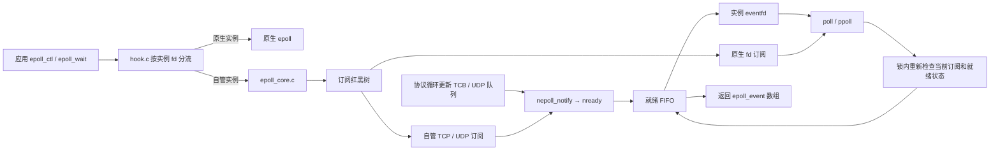
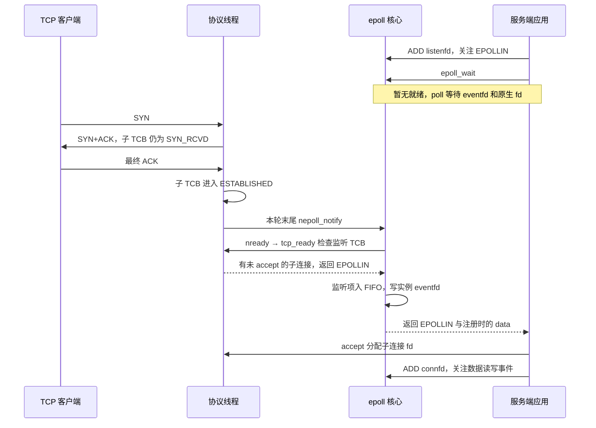

# DPDK 示例中的 epoll 实现

本文以 `examples/13_redis` 为主线，沿用 [TCP 建连示例](TCP_WINDOW_CC_TIMERS.md)，追踪服务端从注册监听 fd，到第三次握手触发 `EPOLLIN`，再到 `accept()` 的过程。图使用 Mermaid。

## 1. 分层与数据结构

`13_redis` 的 epoll 实例由 [epoll_core.c](../epoll_core.c) 实现。实例有一个内核 `eventfd` 作为应用可见的句柄和唤醒通道。订阅关系、就绪队列和事件交付在用户态维护。应用可以把协议栈 TCP/UDP fd 和原生 pipe 等 fd 放进同一个实例。

| 结构或入口 | 作用 |
| --- | --- |
| [hook.c](../hook.c) 的 `epoll_create/create1/ctl/wait/pwait` | 正常运行时创建自管实例。`ctl/wait/pwait` 根据 **epoll 实例 fd** 的归属选择 `nepoll_*` 或原生接口。初始化期和 fork 子进程的新建操作走原生接口 |
| `eventpoll` | 保存句柄 fd、订阅红黑树、就绪 FIFO、关闭状态和等待者引用数 |
| `epitem` | 以被监控的 fd 为树键，保存 fd 类型、注册的 `epoll_event`（含 `data`）、当前就绪掩码及 `is_armed/is_queued` |
| `subscriptions` | 红黑树，保存全部已订阅的 fd，用于 ADD/MOD/DEL 和刷新遍历 |
| `ready_head / ready_tail` | FIFO。每个 `epitem` 最多入队一次。`enqueue()` 会更新掩码，只有已启用且非空就绪的项目才会新入队 |
| `eventfd` | 以非阻塞方式创建。队列新增就绪项或订阅有变动时写入计数，唤醒 `poll/ppoll`。实际事件通过就绪队列交付 |

协议栈 socket fd 自身也由 `socket_fd_alloc()` 用 `eventfd` 分配句柄。识别为协议栈 fd 后，`native_snapshot()` 会跳过该句柄，按 `nready(fd)` 查询 TCP/UDP 状态。参与内核阻塞等待的是 **epoll 实例的 eventfd** 和受监控的原生 fd。 [socket_core.h](../socket_core.h)

## 2. 注册、等待与交付

1. **创建。** `nepoll_create1()` 分配 `eventpoll`，以 `SYS_eventfd2` 创建实例句柄，初始化订阅树并登记所有权。支持 `EPOLL_CLOEXEC`。
2. **注册。** `nepoll_ctl()` 持有 `epoll_lock`，按 fd 查红黑树。ADD 新建 `epitem`，MOD 更新关注掩码和 `data` 并重新启用，DEL 从树和就绪队列摘除项目。ADD/MOD 会立即刷新协议栈订阅，所以注册时已就绪的 socket 可进入 FIFO。成功的 ADD/MOD/DEL 都会写 eventfd，让阻塞线程重建原生 fd 快照。
3. **检查当前状态。** `wait_events()` 读取实例 eventfd 计数，调用 `refresh_stack()`，并为已启用的原生订阅建立 `pollfd` 数组。数组首项是实例 eventfd。它在锁内先做一次零超时 `poll/ppoll`，把原生 fd 的就绪结果也送入同一个 FIFO。事件掩码按 `interest | EPOLLERR | EPOLLHUP` 过滤。
4. **交付。** 从 FIFO 取出最多 `maxevents` 个就绪项。协议栈项出队时再查一次 `nready()`。返回的 `data` 来自用户注册值，`events` 则是实际就绪掩码。LT（水平触发）项回到队尾，下次等待会重新检查。代码以本轮原来的尾节点为边界，避免 LT 项回队后在同一次调用里重复交付。`EPOLLONESHOT` 交付后清除 `is_armed`，需要 MOD 重新启用。
5. **休眠。** 暂无可交付事件时，在锁内再次读取 eventfd 清掉本轮产生的唤醒，然后放锁，用剩余时间阻塞在 `poll/ppoll` 上。此后生产者持锁写入新计数，等待者即使尚未进入系统调用也能看到 eventfd 可读。阻塞快照只用于唤醒，醒来后重新检查当前订阅，因此 MOD/DEL 后按新状态交付。

超时以 `CLOCK_MONOTONIC` 计算截止时间。`timeout=0` 检查一次就绪，负值表示无限等待，有限时间到期且无事件时返回 0。带信号掩码的 `nepoll_pwait()` 使用 `SYS_ppoll`，底层等待被信号打断时可返回 `EINTR`。LT、ONESHOT 和 eventfd 的 Linux 接口背景可查阅 [epoll(7)](https://man7.org/linux/man-pages/man7/epoll.7.html) 与 [eventfd(2)](https://man7.org/linux/man-pages/man2/eventfd.2.html)。

## 3. 用 TCP 握手看监听 fd 如何变为可读

服务端先 `listen()`，再把 `listenfd` 以 `EPOLLIN` 注册。收到 SYN 时，`ng_tcp_process()` 创建 `fd=-1` 的子 TCB，进入 `SYN_RCVD` 并排入 SYN+ACK。这时 `tcp_ready(listenfd)` 仍无可接收连接。收到匹配的最终 ACK 后，子 TCB 进入 `ESTABLISHED`，此时才满足监听就绪条件。

`tcp_ready()` 通过 `listener_fd` 找到属于该监听项、尚未分配 fd、状态为 `ESTABLISHED` 或 `CLOSE_WAIT` 的子连接。`accept()` 成功后为该子连接分配 fd 并清除 `listener_fd`。如果还有其他可接收子连接，监听 fd 下一次等待仍可返回 `EPOLLIN`。

| 被监控对象 | `nready()` 如何判断 |
| --- | --- |
| TCP 监听 fd | 有符合上述条件的子连接时返回 `EPOLLIN` |
| TCP 已连接 fd | 有接收数据、收到对端 FIN 或读侧已关闭时可报 `EPOLLIN`。对端 EOF 还可报 `EPOLLRDHUP`。已连接或处于 `CLOSE_WAIT` 且写侧可用、发送队列有容量时可报 `EPOLLOUT` |
| TCP 非阻塞连接完成 | 成功后状态满足写就绪条件。连接失败时错误字段也会使实现报告 `EPOLLERR`、`EPOLLIN` 和 `EPOLLOUT`。应用可读取 `SO_ERROR` 区分结果 |
| UDP fd | `udp_ready()` 按接收队列、shutdown、发送队列额度和错误字段计算掩码 |
| 原生 fd | 由内核 `poll/ppoll` 的 `revents` 提供，再映射到关注掩码 |

已连接 fd 的读就绪来自接收缓冲和 EOF 状态。`EPOLLOUT` 表示用户态发送队列能接收写入。新段何时实际发送仍由 TCP 的 `cwnd`、对端窗口和输出轮询决定。

## 4. 并发、关闭与实现边界

- **锁序。** `epoll_lock` 保护实例、订阅和 FIFO。`refresh_stack()` 在持有它时调用 `nready()`，后者的 TCP/UDP 实现会取 `socket_state_lock`。协议线程在 TCP/UDP 输入和输出释放 socket 锁后才调用 `nepoll_notify()`，锁序为 `epoll_lock → socket_state_lock`。
- **关闭被监控 fd。** 经 `hook.c:close()` 进入 `nepoll_forget()`，先移除所有实例里的订阅和对应的队列项，写 eventfd 唤醒等待者，再释放 socket 或原生 fd。
- **关闭实例。** `nepoll_forget()` 清除所有权、标记 `is_closed`、删除订阅并唤醒等待者。正在等待的线程重新检查后返回 `EBADF`。最后一个等待者释放引用时关闭 eventfd 并释放实例。
- **功能范围。** 支持 LT 和 `EPOLLONESHOT`。对 `EPOLLET`、`EPOLLEXCLUSIVE`、`EPOLLWAKEUP` 和监控自管 epoll 实例返回 `EOPNOTSUPP`，普通文件与目录返回 `EPERM`。相关 hook 对自管 fd 的复制操作有限制。自管实例应使用 hook 或 `nepoll_*` 入口。
- **扫描开销。** 红黑树提高按 fd 查找订阅的效率。`nepoll_notify()` 仍在每轮遍历所有实例及各自的订阅，`wait_events()` 每轮也会扫描并建立原生快照。原生 fd 的等待使用 `poll/ppoll`，其数组规模随原生订阅数增加。

## 5. 与 12_epoll 示例对照

| 环节 | `examples/12_epoll` | `examples/13_redis` |
| --- | --- | --- |
| 订阅 | `main.c` 中的 `eventpoll.rbr` 红黑树 | `epoll_core.c` 中的 `subscriptions` 红黑树 |
| 事件产生 | 协议处理路径显式调用 `epoll_event_callback()`，例如握手完成时通知监听 fd | 协议循环末尾调用 `nepoll_notify()`，用 `nready()` 查询当前状态 |
| 就绪组织 | `rdlist` 头插，`rdy` 去重，`nepoll_wait()` 取出后清除就绪标记 | FIFO 尾插，`is_queued` 去重，LT 项重新排队，ONESHOT 项交付后停用 |
| 休眠 | `pthread_cond_wait()/timedwait()`，回调 signal | 实例 `eventfd` 与原生 fd 共用 `poll/ppoll` |

`12_epoll` 的 `nepoll_wait()` 出队逻辑带有 `EPOLLET` 注释。它体现的是回调入队、消费后清标记的示例行为。详细结构与回调位置可查阅 [12_epoll/main.c](../../12_epoll/main.c) 和 [12_epoll 的设计笔记](../../12_epoll/EPOLL_DESIGN.md)。

## 6. 源码导航

| 位置 | 阅读入口 |
| --- | --- |
| [epoll_core.c](../epoll_core.c) | 数据结构（23–47）、`enqueue()`（70）、`nepoll_notify()`（118）、`nepoll_ctl()`（172）、`wait_events()`（268）、`nepoll_forget()`（369） |
| [hook.c](../hook.c) | 实例所有权分派及 `close()`（465–499） |
| [main.c](../main.c) | `pkt_process()` 的 TCP/UDP 分流与 `nepoll_notify()`（585–644） |
| [socket_api.h](../socket_api.h)、[tcp_core.h](../tcp_core.h)、[udp_core.h](../udp_core.h) | `nready()`（410）→ `tcp_ready()`（1102）或 `udp_ready()`（561） |
| [test_epoll_core.c](../tests/test_epoll_core.c) | 核心测试覆盖混合 fd、阻塞唤醒、LT、超时、EINTR、信号掩码和关闭已入队的 fd |
