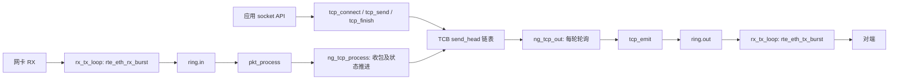
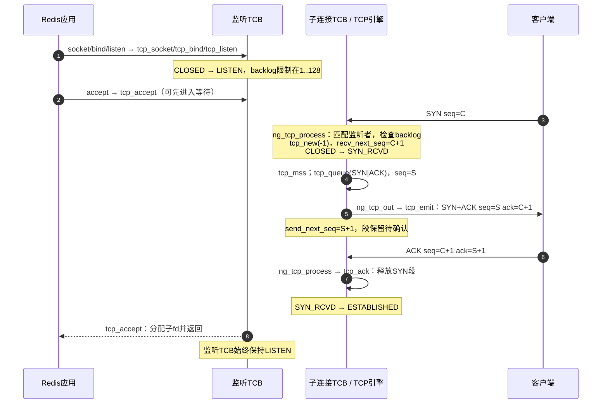
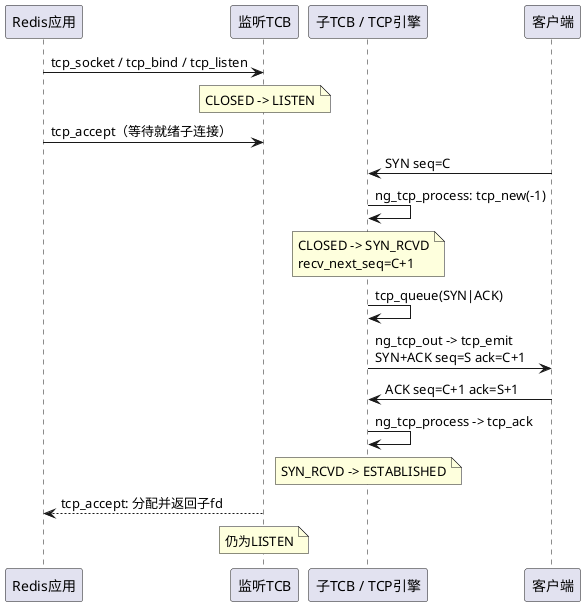
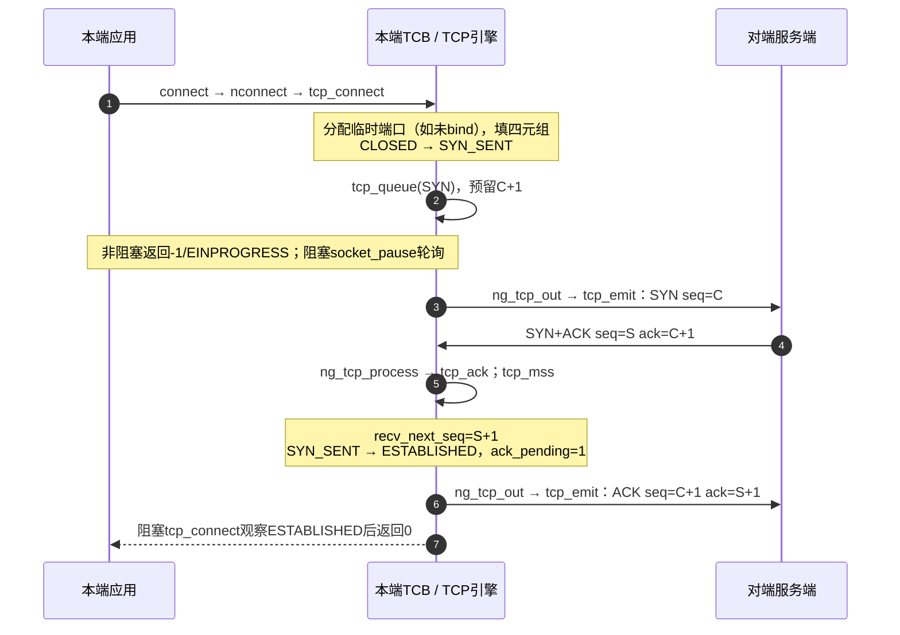
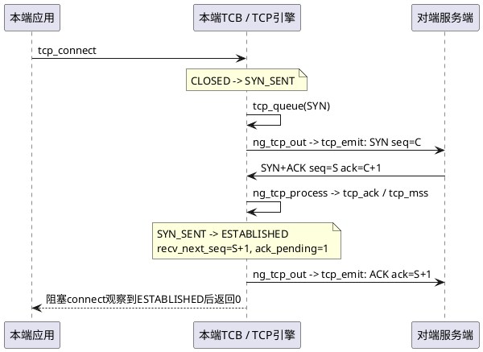
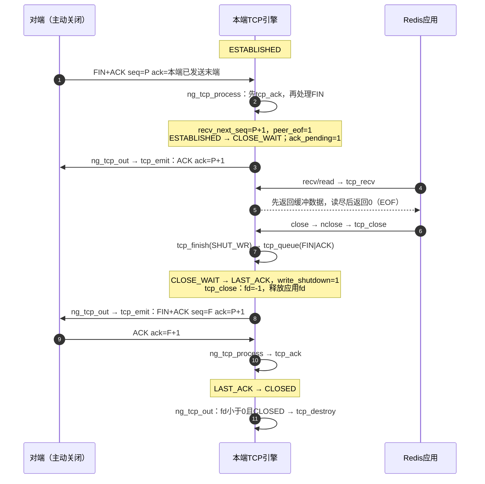
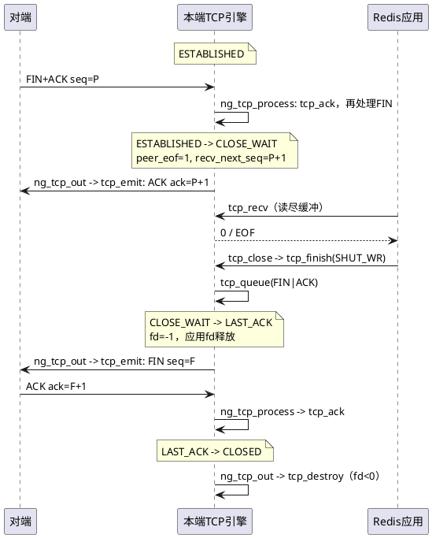
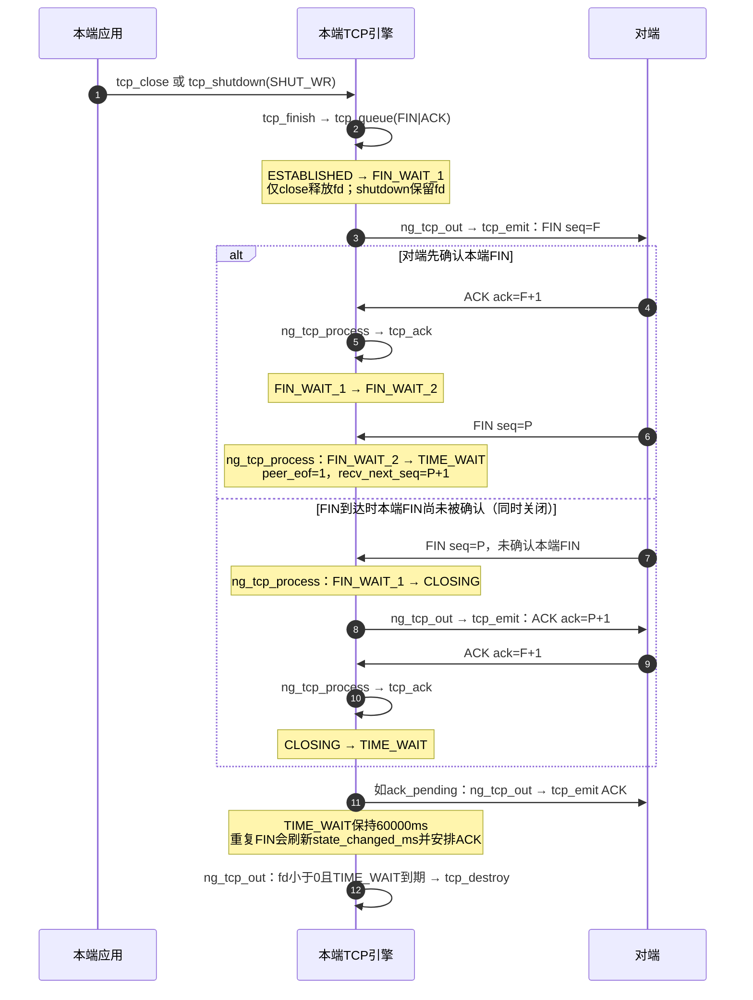
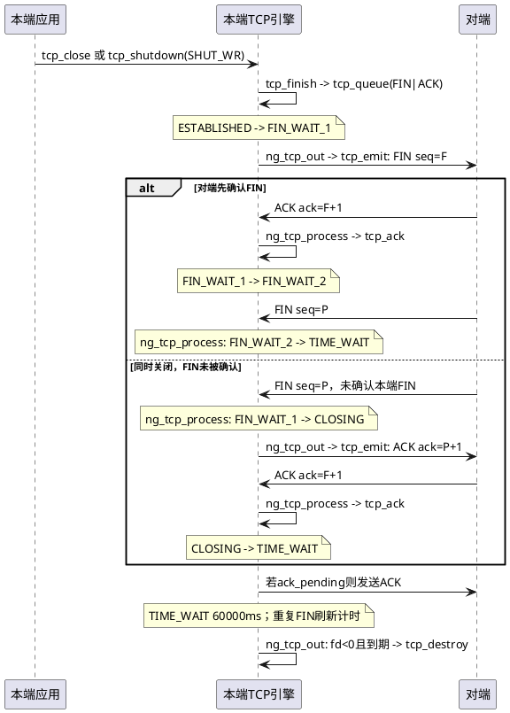
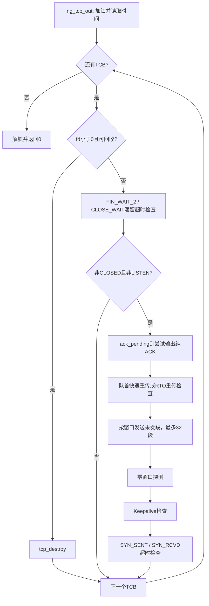

# 13_redis：TCP 建立、收发与断链流程

本文按当前 `examples/13_redis` 源码整理，重点是用户态 TCP 引擎，而非仅描述标准 TCP。图同时提供 Mermaid 与 PlantUML 源码；使用支持对应语法的 Markdown 插件渲染即可。文中的状态名省略 `NG_TCP_STATUS_` 前缀。

## 1. 源码导航与接口分层

| 位置 | 作用 |
| --- | --- |
| `tcp_core.h:14–57` | 状态枚举、发送段 `tcp_seg`、连接控制块 `ng_tcp_stream` |
| `tcp_core.h:104–167` | `tcp_new` 创建 TCB，`tcp_queue` 排队并预留序号 |
| `tcp_core.h:171–235` | `tcp_emit`：ARP 查询、封包、入输出 ring |
| `tcp_core.h:245–293` | `tcp_ack`：累计确认、释放发送队列、推进关闭状态 |
| `tcp_core.h:320–523` | `ng_tcp_process`：输入校验、连接查找、握手、ACK、数据、FIN/RST |
| `tcp_core.h:525–640` | `ng_tcp_out`：ACK、重传、窗口限制、探测、超时和回收 |
| `tcp_core.h:738–871` | `tcp_listen`、`tcp_accept`、`tcp_connect` |
| `tcp_core.h:873–1072` | `tcp_send/recv`、`tcp_finish/shutdown/close` |
| `tcp_cc.h` | Reno 拥塞控制与 RTT/RTO 计算 |
| `socket_api.h:153` | `tcp_ops` 将通用 socket 操作映射到 TCP 实现 |
| `hook.c` | 对受管理 fd，POSIX 接口转到 `nlisten/nconnect/naccept/nshutdown/nclose` 等 |
| `main.c:585–648,1153–1188` | 协议处理循环、RX/TX 循环以及 ring 交接 |

调用层次：应用 POSIX 接口 → `hook.c` → `n*` 接口 → `socket_ops`/`tcp_ops` → `tcp_*`。如直接使用 `n*` API，则不需要经过 POSIX hook。

应用调用与协议循环通过全局 `socket_state_lock` 保护 TCB/队列。阻塞 `connect/accept/send/recv` 使用 `socket_pause()`：释放全局锁、休眠约 1 ms、重新加锁检查条件，并非一直持锁等待，也不是依靠 TCB 的 `cond` 唤醒。每轮协议循环最后调用 `nepoll_notify()` 检查就绪状态。

注意：`sndbuf/rcvbuf` 字段只是兼容保留。当前发送使用 `send_head/send_tail` 链表，接收使用 `recv_buffer` 循环数组，不要将它们与网卡收发的 `ring.in/ring.out` 混淆。

## 2. 序号与 TCB 关键字段

| 字段 | 含义及更新位置 |
| --- | --- |
| `status` | TCB 当前状态；`tcp_new` 零初始化，对应 `CLOSED` |
| `send_queued_end_seq` | 已排队序号空间的末端；`tcp_queue` 立即推进，即使尚未发出 |
| `send_next_seq` | 成功放入输出 ring 的新段末端；首次发送成功时由 `ng_tcp_out` 推进 |
| `congestion.send_unacked_seq` | 最早未确认序号，由 `tcp_ack/tcp_cc_ack` 推进 |
| `recv_next_seq` | 下一个期望接收的序号，也是输出 TCP 头的 ACK 值 |
| `ack_pending` | 待回 ACK/窗口更新；成功 `tcp_emit` 后清零 |
| `peer_eof` | 已接收对端 FIN；接收缓冲读完后 `tcp_recv` 返回 0 |
| `write_shutdown` | 本端写方向关闭，继续发送返回 `EPIPE` |
| `fd / listener_fd` | 应用描述符 / 所属监听者；未 accept 的子 TCB 的 fd 为 -1 |
| `state_changed_ms` | 关闭状态计时等；并非每个 status 赋值处都会刷新 |

`tcp_seg_end = start_seq + payload_len + SYN占用的1 + FIN占用的1`。纯 ACK 不消耗序号，也不进入可靠发送队列。下面用客户端初始序号 C、服务端初始序号 S 表示握手；以 F、P 表示两端 FIN 的序号，假设图中 FIN 已轮到发送、没有未展示的数据。

### 2.1 `ng_tcp_stream` 全字段说明：身份、状态与生命周期

TCB（Transmission Control Block）是一个连接的协议状态集合。本实现也用同一结构表示尚未连接的 socket 和监听 socket。字段默认由 `tcp_new()` 的 `rte_zmalloc` 清零；下表注明非零初值或特殊初始化。除特别说明外，序号/计数使用主机字节序，时间戳使用 `socket_now()` 的单调时钟毫秒值。

| 变量（类型） | 作用、初值与主要使用位置 |
| --- | --- |
| `fd`（int） | 应用描述符。`tcp_new(fd)` 设置；被动子连接创建时为 -1，`tcp_accept` 分配后变为有效 fd，`tcp_close` 后恢复 -1。决定应用可否访问以及输出循环可否销毁对象；-1不代表TCP握手或断链已经结束。 |
| `local_ip`（uint32_t） | 本端 IPv4，网络字节序。bind 设置，0可表示通配监听；主动连接取栈地址，被动子连接取输入目的地址。用于四元组查找与输出IP头。 |
| `local_mac`（uint8_t[6]） | 本端源MAC，创建时从 `g_port_mac_addr` 复制，`tcp_emit` 填入以太网头。 |
| `local_port`（uint16_t） | 本端端口，网络字节序。bind指定或临时端口分配，被动子连接继承输入目的端口；用于监听匹配及TCP头。 |
| `protocol`（uint16_t） | 创建时设为 `IPPROTO_TCP`，表示协议类型；不是TCP flags。 |
| `peer_port`（uint16_t） | 对端端口，网络字节序。connect或接收SYN时设置；除四元组外，也用于判断是否已指定过对端等接口条件。 |
| `peer_ip`（uint32_t） | 对端IPv4，网络字节序；用于四元组匹配、输出IP头及ARP目的查询。 |
| `status`（NG_TCP_STATUS） | 当前TCP状态。零值为CLOSED；握手、ACK、FIN、错误及关闭接口推进它，详见状态表。 |
| `prev`（ng_tcp_stream*） | 全局TCB双向链表前驱；由 `LL_ADD/LL_REMOVE` 维护。 |
| `next`（ng_tcp_stream*） | 全局TCB双向链表后继；输入查找、输出遍历及accept扫描都使用该链表。它不是发送段链表指针。 |
| `listener_fd`（int） | 初值 -1。未accept子连接记录其监听fd，用于backlog计数、accept归属和监听关闭时清理；accept成功后置 -1。 |
| `backlog`（int） | 监听者允许的未accept子连接数量上限，`tcp_listen` 将参数限制为1..128；半连接与已完成握手但未accept的连接共用限额。 |
| `flags`（int） | socket文件状态标志，当前主要保存 `O_NONBLOCK`，由socket类型及 `tcp_fcntl(F_SETFL)` 设置；决定阻塞接口是否立即返回。不是报文头flags。 |
| `error`（int） | 待观察的连接错误码，初值0；`tcp_fail` 写入 `ENOMEM/ETIMEDOUT/ECONNRESET/ECONNREFUSED` 等并置CLOSED，connect/send/recv和就绪查询据此报告失败。 |
| `state_changed_ms`（uint64_t） | 创建时设当前时间；connect、部分关闭转换、失败及TIME_WAIT重复FIN等路径更新，用于握手超时、关闭滞留和TIME_WAIT计时。源码并非每次状态变化都更新，不能当成严格的“最后状态转换时间”。 |

### 2.2 发送、接收、序号与窗口

| 变量（类型） | 作用、更新时机与区别 |
| --- | --- |
| `send_next_seq`（uint32_t） | 下一个首次提交输出的序号，类似SND.NXT。创建时生成初始序号ISN；`ng_tcp_out` 首次成功输出新段后更新为该段末端。重传不会再次推进。 |
| `send_queued_end_seq`（uint32_t） | 已排队序号空间末端，初值等于ISN；`tcp_queue` 入队便推进，包括SYN/FIN各占1。可领先于 `send_next_seq`；用于握手与FIN确认校验。 |
| `recv_next_seq`（uint32_t） | 下一个期望序号，类似RCV.NXT；SYN后设为对端ISN+1，实际接收数据/FIN后推进。`tcp_emit` 用它填写ACK字段。应用读取数据不会回退它。 |
| `send_head`（tcp_seg*） | 可靠发送链表队首，可能是已发待确认段，也可能是未发段；输出循环从此扫描，重传重点检查队首，ACK使其前移。 |
| `send_tail`（tcp_seg*） | 发送链表尾，供 `tcp_queue` 追加、窗口拆段维护；队列清空时置NULL。 |
| `send_queue_bytes`（uint32_t） | 队列中尚未确认的payload字节数，包括未发和已发待确认数据。入队增加，完整或部分确认减少；不计SYN/FIN消耗的序号。`tcp_send` 用 `TCP_TX_CAP - send_queue_bytes` 判定剩余容量，容量为1MiB。 |
| `congestion`（tcp_cc） | 嵌入的拥塞控制/RTT/RTO状态，全部子字段见2.5；其中SND.UNA与本表两个发送序号共同描述发送进度。 |
| `recv_buffer`（unsigned char*） | 创建时分配65535字节循环接收缓冲，输入复制数据，`tcp_recv` 复制给应用，`tcp_destroy` 释放；并非mbuf或乱序队列。 |
| `recv_read_offset`（uint32_t） | 循环缓冲当前读起点，初值0。普通recv消费后按65535取模推进；`MSG_PEEK` 不推进。写入位置为 `(recv_read_offset + recv_buffer_bytes) % TCP_RX_CAP`。 |
| `recv_buffer_bytes`（uint32_t） | 尚未被应用消费的数据量。输入接收增加，普通recv减少，读关闭清零；决定本端通告窗口 `TCP_RX_CAP - recv_buffer_bytes`。 |
| `peer_recv_window`（uint32_t） | 对端通告的接收窗口，初值65535；握手及有效窗口更新报文设置。与cwnd取最小值限制发送，为0时触发零窗口探测。它与本端缓冲剩余容量是两个方向的概念。 |
| `last_window_update_seq`（uint32_t） | 最近一次被接受的窗口更新报文seq，类似SND.WL1。输入seq更新，或seq相同且ack不旧时，才允许更新对端窗口，以避免旧包覆盖较新窗口。 |
| `last_window_update_ack`（uint32_t） | 对应窗口更新报文ack，类似SND.WL2；与上一字段一起判断更新先后，握手时也初始化。 |
| `ack_pending`（int） | 待发送确认/窗口更新标记。数据、FIN、重复或乱序报文、应用读数据腾出空间等置1；`ng_tcp_out` 尝试发纯ACK，成功 `tcp_emit` 后清零。它不表示等待对端确认。 |
| `peer_eof`（int） | 已按序消费对端FIN。阻止继续按普通数据路径接收新payload，并让 `tcp_recv` 在读尽缓冲后返回EOF；不能用它判断本端FIN是否被确认。 |
| `read_shutdown`（int） | 本端调用SHUT_RD/SHUT_RDWR后置1，并清空当前接收缓存；`tcp_recv` 在缓冲分支之后检查它。它不发送FIN；输入函数没有以此字段禁止后续数据入缓冲。 |
| `write_shutdown`（int） | 成功排队本端FIN后置1，`tcp_send` 据此返回EPIPE；不能等同于FIN已经上网或被对端确认。 |

例如，没有序号回绕且队列正常时：`send_unacked_seq=1000`、`send_next_seq=2000`、`send_queued_end_seq=3000` 表示 `[1000,2000)` 已提交但未确认，`[2000,3000)` 已排队尚未提交。实际代码用 `tcp_seq_before/after` 处理32位序号回绕，不能直接用普通大小比较替代。

### 2.3 Socket选项、保活与探测计时

| 变量（类型） | 作用及主要更新者 |
| --- | --- |
| `reuse_address`（int） | SO_REUSEADDR的布尔值，`tcp_setsockopt` 设置，bind的端口/IP冲突检查使用；不是无条件允许多个监听者占同一端口。 |
| `no_delay`（int） | TCP_NODELAY设置/查询的存储值。当前发送路径没有读取它来切换Nagle行为，所以不能据此宣称实现了Nagle开关。 |
| `keepalive_enabled`（int） | SO_KEEPALIVE开关，默认0。输出循环只在启用、ESTABLISHED且无发送队列等条件满足时探测；设置该选项还重置探测计数和接收活跃时间。 |
| `keepalive_probe_limit`（int） | 允许的保活探测次数，默认9；TCP_KEEPCNT可修改。到下一次探测检查且已达到上限时，`tcp_fail(ETIMEDOUT)`。 |
| `keepalive_probes_sent`（int） | 当前连续保活探测发送次数；探测成功入输出ring才增加，有效普通接收路径及设置SO_KEEPALIVE时清零。 |
| `keepalive_idle_sec`（uint32_t） | 保活空闲阈值，单位秒，默认300；TCP_KEEPIDLE可修改。输出时换算为毫秒与 `last_received_ms` 比较。 |
| `keepalive_interval_sec`（uint32_t） | 保活探测间隔，单位秒，默认75；TCP_KEEPINTVL可修改。与最近保活探测时间比较。 |
| `last_received_ms`（uint64_t） | 创建时置当前时间，普通输入通过序号检查后更新，用于保活空闲判断；并非每个被调用输入函数看到的包都会刷新，例如握手专用提前返回路径。 |
| `last_keepalive_probe_ms`（uint64_t） | 最近成功提交保活探测的时间，初值0，控制探测间隔。 |
| `last_window_probe_ms`（uint64_t） | 最近零窗口探测尝试时间，初值0；输出循环在探测分支调用 `tcp_emit` 后更新，未检查其返回值。与保活探测成功才计时的处理不同。 |
| `last_arp_request_ms`（uint64_t） | 最近ARP请求尝试时间，初值0；目的MAC未知时，`tcp_emit` 据此将ARP请求尝试限制为每秒一次，即使ARP分配/入队失败也更新时间。 |

### 2.4 保留字段与同步方式

| 变量（类型） | 当前实现实际作用 |
| --- | --- |
| `sndbuf`（rte_ring*） | 源码注释标明为兼容保留；当前TCP发送不通过它，而通过 `send_head/send_tail`。同名UDP字段不代表TCP也使用ring缓存。 |
| `rcvbuf`（rte_ring*） | 兼容保留；当前TCP接收使用 `recv_buffer`，不是此ring。 |
| `cond`（pthread_cond_t） | 当前TCP引擎没有用它执行条件等待/通知；不能将它画成connect/accept的唤醒机制。 |
| `mutex`（pthread_mutex_t） | 当前TCP引擎没有用它加锁保护该连接；实际使用全局 `socket_state_lock`，阻塞等待通过 `socket_pause` 暂时释放全局锁。 |

### 2.5 `congestion` 内部所有变量（`struct tcp_cc`）

| 变量 | 作用、初值与更新逻辑 |
| --- | --- |
| `send_unacked_seq` | 最早未确认序号，类似SND.UNA，初值ISN；推进ACK时由 `tcp_cc_ack` 更新。与 `send_next_seq` 的差值是当前已提交未确认的序号空间。 |
| `max_segment_size` | 发送MSS，默认1460；`tcp_mss` 可按对端SYN选项调小，连接前TCP_MAXSEG也可设置；`tcp_send` 据此分段，拥塞算法也使用它。 |
| `congestion_window` | 拥塞窗口cwnd，单位字节，初值10×MSS；ACK推进时慢启动/拥塞避免增长，快恢复时调整，RTO超时时降至1×MSS；ACK更新时限制上限65535。 |
| `slow_start_threshold` | 慢启动阈值ssthresh，初值65535；丢包处理时设为 `max(in_flight/2, 2×MSS)`，决定增长阶段及快恢复退出后的窗口。 |
| `duplicate_ack_count` | 连续重复ACK计数，第3个触发快速重传/进入快恢复；ACK推进或RTO超时清零。 |
| `recovery_end_seq` | 进入快恢复时记录当时 `send_next_seq`。当前代码只写入，没有用它判断恢复完成；实现为Reno，在首个推进ACK处退出快恢复，不能解释成NewReno的恢复边界控制。 |
| `avoidance_acked_bytes` | 拥塞避免阶段累计确认字节数，达到一个cwnd后减去该cwnd并增加1×MSS；初始化及RTO超时时清零。 |
| `smoothed_rtt_ms` | 平滑RTT（SRTT），初值0表示尚无样本；首样本直接赋值，后续约按旧值7/8与新样本1/8加权。 |
| `rtt_variation_ms` | RTT变化量（RTTVAR），初样本/2，后续旧值3/4与绝对偏差1/4加权，参与RTO计算。 |
| `retransmit_timeout_ms` | RTO，初值1000ms；RTT采样更新为 `SRTT+4×RTTVAR` 并限制在1000..60000ms；超时重传倍增，上限60000ms。 |
| `retransmit_count` | 拥塞模块级累计重传事件计数，在第3重复ACK触发及RTO超时处理时增加。与每个 `tcp_seg.retransmit_count` 不同，不用于单段8次重试上限判断。 |
| `in_fast_recovery` | 快恢复布尔标记；第3重复ACK置1，首个推进ACK或RTO超时清零；快恢复期间后续重复ACK可扩张cwnd。 |

RTT仅从未重传过的已确认段取样，避免把重传确认误当作首发的往返时间；该判断依赖下面的单段发送记录。

### 2.6 发送队列节点所有变量（`struct tcp_seg`）

| 变量 | 作用与生命周期 |
| --- | --- |
| `next` | 下一发送段指针，ACK释放队首、排队和窗口拆段会维护它。 |
| `start_seq` | 本段首序号，入队取当前 `send_queued_end_seq`；部分ACK裁剪后改为ACK值，窗口拆段也会计算剩余段首序号。 |
| `payload_len` | 本段数据字节数，不包括SYN/FIN占用序号；部分确认/窗口拆段会缩小它。 |
| `flags` | 本段TCP标志：如SYN、SYN+ACK、ACK+PSH、FIN+ACK；`tcp_emit` 用来填TCP头，与TCB的文件状态 `flags` 无关。 |
| `was_sent` | 初值0；首次成功入输出ring后置1，用于区分未发段和待ACK段。网卡是否真正发送、对端是否收到由后续行为判断。 |
| `retransmit_count` | 单段成功重传次数，初值0，成功重传后增加；达到8次后在下次重传检查时报ETIMEDOUT，也用于判断是否允许RTT采样。 |
| `last_sent_ms` | 最近一次提交时间，首次发送和重传成功后更新；ACK推进还会重启剩余已发队首计时。特殊值0请求重传，例如重复SYN或快速重传。 |
| `first_sent_ms` | 首次提交时间，首次发送成功记录；未重传段得到确认时计算RTT样本，重传不覆盖此值。 |
| `data` | 本段payload副本，`tcp_queue` 分配并复制；无payload时为NULL，部分ACK可原地裁剪；最终 `tcp_seg_free` 释放。 |

## 3. 被动建立连接：Redis 服务端

监听 TCB 与子 TCB 是两个对象。`tcp_listen()` 只让监听对象 `CLOSED → LISTEN`；收到 SYN 后 `tcp_new(-1)` 创建子连接，监听者不会变为 `SYN_RCVD`。

接收首个 SYN 时，源码要求 SYN/ACK/RST 这三位组合为“仅 SYN”，并用四元组建立子 TCB。backlog 统计同一 `listener_fd` 且 `fd < 0` 的所有子连接，因此半连接和已完成但未 accept 的连接共用此计数；满时不创建新 TCB，此分支直接结束处理。

第三次握手必须满足：有 ACK、`ack_seq == send_queued_end_seq`、`send_next_seq == send_queued_end_seq`、`segment_seq == recv_next_seq`。后一个发送条件保证 SYN+ACK 已成功进入输出 ring。通过后，`tcp_ack` 清除 SYN 段，状态变为 `ESTABLISHED`，并继续走普通接收逻辑，所以第三次握手携带的数据也可被处理。

同序号的重传 SYN 在 `SYN_RCVD` 中把队首 `last_sent_ms` 清零，让输出循环安排重发。`tcp_accept` 只挑选 `ESTABLISHED` 或 `CLOSE_WAIT` 的未接收子 TCB；后者允许客户端握手后很快发送 FIN 的情况。无可接收连接时，非阻塞返回 `EAGAIN`，阻塞调用轮询等待。

### PlantUML 等价时序

## 4. 主动建立连接

返回成功与 ACK 实际发到网卡之间没有同步屏障：上图画出正常协议顺序，应用可能在 `ack_pending` 真正输出前观察到 `ESTABLISHED`。主动握手只接受有效 SYN+ACK，且要求对本端 SYN 的确认值正确、SYN 已成功提交输出。当前实现没有主动同时打开的 SYN-only 分支。

## 5. 被动断链：对端先发 FIN

`CLOSE_WAIT` 表示对端已经停止发送，本端仍可 `tcp_send`；它不等于完整连接已销毁。调用 `shutdown(SHUT_WR)` 同样经 `tcp_finish` 发送 FIN，但保留应用 fd，因此最终 `CLOSED` 后不会自动满足 `fd < 0` 的回收条件，仍需 `close()`。

## 6. 主动断链与同时关闭

如果一个包同时含“确认本端 FIN 的 ACK”和“对端 FIN”，输入函数先执行 `tcp_ack`，将 `FIN_WAIT_1 → FIN_WAIT_2`，然后处理 FIN 直接进入 `TIME_WAIT`，不经过 `CLOSING`。

源码在 TIME_WAIT 到期且 `fd < 0` 时直接销毁 TCB，并没有先赋值为 `CLOSED`；图中应理解为对象生命周期结束。若只调用 shutdown、仍持有 fd，输出循环不会按该条件销毁 TIME_WAIT TCB。

## 7. `ng_tcp_process(packet)` 逐步解析

此函数消费输入 mbuf：校验失败路径和正常结束路径都会 `rte_pktmbuf_free(packet)`；调用者不能再使用或重复释放。返回 0 也可能表示忽略、丢弃或只设置了待发送 ACK，并不代表应用收到数据。

1. **报文校验（322–350）**：当前 mbuf 数据区至少包含以太网头及最小 IPv4/TCP 头；IPv4 必须为版本4、20字节头、长度有效、未分片、目的地址为 `g_stack_ipv4_addr`，并通过 `socket_ipv4_valid`；TCP data offset 合法；将 TCP 校验和临时置零重算并比对。此实现不重组 IPv4 分片，也不处理 IPv4 options。
2. **解析并加锁（351–367）**：payload 长度扣除 IP/TCP 头；seq/ack/window 转主机序。遍历 TCB，记录本地端口/IP匹配的监听者，同时优先查找已有连接四元组。端点 IP/端口字段保存网络字节序。
3. **新 SYN（368–392）**：无已有连接但匹配 listener 时检查 backlog，创建 `fd=-1` 子 TCB，设置四元组、`listener_fd`、`recv_next_seq=seq+1`、接收窗口和 MSS；进入 `SYN_RCVD`，只把 SYN+ACK 排入可靠发送队列。内存失败走 `tcp_fail(ENOMEM)`。
4. **无匹配连接（394–413）**：收到 RST 时不回复；其他包尝试直接 `tcp_emit` RST。输入带 ACK 时输出 RST 的 seq 取输入 ack；不带 ACK 时输出 RST+ACK，确认 payload/SYN/FIN 的序号空间。这种临时 reset 不建立可靠发送队列，输出失败不会持久重试。
5. **RST（414–423）**：`SYN_SENT` 要求有 ACK 且 ACK 匹配排队末端，失败原因为 `ECONNREFUSED`；其他状态要求输入 seq 正好等于 `recv_next_seq`，则 `ECONNRESET`。`tcp_fail` 保存错误并置 `CLOSED`，并不发送 FIN。
6. **握手状态（424–455）**：`SYN_SENT` 校验 SYN+ACK 后确认 SYN、记录对端窗口/MSS、进入 `ESTABLISHED` 并置 `ack_pending`，随后直接结束本次输入；`SYN_RCVD` 处理重传 SYN 或有效第三次 ACK，通过后继续普通接收。因此主动握手分支中的 SYN+ACK payload 不在该次调用交付。
7. **接收序号检查（456–465）**：跳过 CLOSED/LISTEN；未来序号或完全过旧的段只安排累计 ACK，不保存乱序队列。重叠段可在后续去掉重复前缀。
8. **活跃时间与 ACK（466–485）**：刷新 `last_received_ms`、清 keepalive 探测数；ACK 超过 `send_next_seq` 则只安排 ACK 后结束。其余交给 `tcp_ack`，按 seq/ack 的新旧条件更新对端窗口。无 payload、无 SYN/FIN、窗口值不变是重复 ACK 候选条件，最终还须 ACK 等于最早未确认序号。
9. **数据（486–502）**：尚未 EOF 时裁去重复前缀，最多复制接收缓冲剩余容量，环形写入并推进 `recv_buffer_bytes/recv_next_seq`，设置 `ack_pending`。超容量部分不确认，靠对端后续重传恢复。
10. **FIN（503–518）**：TIME_WAIT 收 FIN 刷新计时。新 FIN 仅在 `segment_seq+payload_len == recv_next_seq` 时被消费：序号加1，置 `peer_eof/ack_pending`，推进 `ESTABLISHED→CLOSE_WAIT`、`FIN_WAIT_1→CLOSING` 或 `FIN_WAIT_2→TIME_WAIT`。若数据未完整收下，FIN 不会被提前消费；重复 FIN/SYN 仍安排 ACK。
11. **收尾（519–523）**：解全局锁、释放输入 mbuf。应用读数据、错误或 EOF，由后续 `tcp_recv` 等调用观察；事件通知由外层 `pkt_process` 的 `nepoll_notify` 完成。

### `tcp_ack` 为什么决定关闭状态

- 先拒绝超过已提交发送末端、或落后于最早未确认点的 ACK。
- ACK 未推进且符合 duplicate 条件时进入 `tcp_cc_dupack`；第三次重复 ACK 将队首 `last_sent_ms=0`，请求快速重传。
- ACK 推进时释放被完整确认的段；部分确认的数据段裁掉前缀；仅对未重传过的段采样 RTT，再调用 `tcp_cc_ack` 更新 Reno 状态。
- 已发送的剩余队首重启重传计时。
- 只有 ACK 恰好等于 `send_queued_end_seq`，才执行 `FIN_WAIT_1→FIN_WAIT_2`、`LAST_ACK→CLOSED`、`CLOSING→TIME_WAIT`。FIN 在此前已排队数据之后，因此该条件表示整个发送方向已确认。

## 8. `ng_tcp_out(packet_pool)` 逐步解析

此函数每轮协议循环都会执行，即使没有新输入包，也能处理重传和定时清理。它持有全局锁遍历全部 TCB，预存 `next` 以便安全删除当前对象。

| 顺序 | 动作 | 关键条件/效果 |
| --- | --- | --- |
| 1 | 回收 | `fd<0` 且 CLOSED，或 `fd<0` 且 TIME_WAIT 满60000ms，调用 `tcp_destroy` |
| 2 | 关闭滞留检查 | FIN_WAIT_2/CLOSE_WAIT、`fd<0`、停留超过120000ms，`tcp_fail(ETIMEDOUT)`；通常下一轮回收 |
| 3 | 输出纯 ACK | 非 CLOSED/LISTEN 且 `ack_pending`，`tcp_emit(send_next_seq, ACK)`；先于重传和新数据 |
| 4 | 队首重传 | 队首已发，窗口非零或为 SYN，且 `last_sent_ms==0` 或 RTO 到期 |
| 5 | 发送新段 | 每连接每轮最多成功输出32个未发段；受拥塞窗口和对端窗口限制 |
| 6 | 零窗口探测 | 有发送队列、对端窗口为0、达到RTO间隔，发 `seq=send_next_seq-1` 的纯 ACK |
| 7 | Keepalive | 显式启用、ESTABLISHED、发送队列空、空闲及间隔均达标；探测耗尽后超时 |
| 8 | 握手超时 | SYN_SENT/SYN_RCVD 从 `state_changed_ms` 起超过120000ms，置错误并 CLOSED |

**重传细节**：队首 `retransmit_count>=8` 时置 `ETIMEDOUT`；否则成功 `tcp_emit` 后增加次数并更新时间。RTO 到期重传调用 `tcp_cc_timeout`：拥塞窗口降到一个 MSS，RTO 倍增，上限60秒。`last_sent_ms==0` 表示主动请求重发，成功后不走该超时退避分支。只有成功进入输出 ring 才计为一次重传；ARP/内存/ring 失败不消耗重传次数。

**新段与窗口**：`send_window=min(congestion_window, peer_recv_window)`，`in_flight=send_next_seq-send_unacked_seq`。SYN 可绕过数据窗口检查；数据和 FIN 需要可用窗口。有空间但不足一个数据段时拆成当前段和剩余段，保持总排队字节数及排队末端不变。`tcp_emit` 失败则中断该连接的新段发送；成功才设置 `was_sent`、首次/最近发送时间，推进 `send_next_seq`。段不会因此出队，必须等 `tcp_ack` 确认后释放。

**参数**：本地 MSS 默认1460，SYN MSS 选项可将其调小（接受64及以上且小于当前值的值）；初始拥塞窗口为10×MSS，初始 RTO 为1000ms，RTT 算法将 RTO 限在1000–60000ms。默认 keepalive 未启用，参数为 idle=300秒、interval=75秒、探测上限9次；不要将其与120秒握手/特定关闭状态清理混为一谈。

### `tcp_emit` 与网卡发送之间的边界

1. `ng_get_dst_macaddr(peer_ip)` 查 ARP。未知时最多每秒尝试发一次 ARP request，并返回 -1，原 TCP 段仍留队待后续循环尝试。
2. 从池分配 mbuf，封装 Ethernet + IPv4 + TCP + 数据；SYN 加4字节 MSS 选项。TCP ACK 使用当前 `recv_next_seq`，通告窗口为 `65535-recv_buffer_bytes`；计算 IPv4/TCP 校验和。
3. `rte_ring_mp_enqueue(ring.out, packet)` 成功后才清 `ack_pending` 并返回0；失败释放新 mbuf。
4. `rx_tx_loop` 从 `ring.out` 取包，再调用 `rte_eth_tx_burst`；未被网卡接受的尾部 mbuf 会释放。可靠段仍保存在 TCB，可依靠重传恢复。

因此 `tcp_emit` 成功表示输出 ring 已接收，不能解释为对端已收到，也不能解释为网卡已成功提交。纯 ACK 没有可靠队列；其丢失依靠后续报文或对端重传再触发确认。

## 9. 完整状态变化速查

| 当前状态 | 触发及接口 | 后继状态 |
| --- | --- | --- |
| CLOSED | `tcp_listen` | LISTEN |
| CLOSED | `tcp_connect`，SYN排队 | SYN_SENT |
| 新建子TCB | `ng_tcp_process` 收监听端口SYN | SYN_RCVD（监听者保持LISTEN） |
| SYN_SENT | `ng_tcp_process` 收有效SYN+ACK | ESTABLISHED |
| SYN_RCVD | `ng_tcp_process` 收有效ACK | ESTABLISHED |
| ESTABLISHED | `ng_tcp_process` 消费FIN | CLOSE_WAIT |
| ESTABLISHED | `tcp_finish` 关闭写方向 | FIN_WAIT_1 |
| CLOSE_WAIT | `tcp_finish` 关闭写方向 | LAST_ACK |
| FIN_WAIT_1 | `tcp_ack` 确认本端FIN | FIN_WAIT_2 |
| FIN_WAIT_1 | `ng_tcp_process` 消费对端FIN，本端FIN尚未确认 | CLOSING |
| FIN_WAIT_2 | `ng_tcp_process` 消费对端FIN | TIME_WAIT |
| CLOSING | `tcp_ack` 确认本端FIN | TIME_WAIT |
| LAST_ACK | `tcp_ack` 确认本端FIN | CLOSED |
| 活动状态 | 有效RST / 超时 / 部分内存错误 → `tcp_fail` | CLOSED，保存错误 |
| LISTEN | `tcp_close`，销毁未accept子连接 | CLOSED，释放fd |
| SYN_SENT/SYN_RCVD | `tcp_close` | CLOSED，释放fd，无FIN |
| CLOSED或到期TIME_WAIT | `ng_tcp_out` 且fd小于0 | TCB销毁；到期TIME_WAIT不额外赋CLOSED |

## 10. 阅读与调试时的注意点

- 建连包和 FIN 都通过 `tcp_queue` 可靠排队；状态可能在报文真正发出前已改变。`tcp_send` 成功同样仅表示数据已排队。
- `shutdown(SHUT_RD)` 清读缓冲并设置 `read_shutdown/ack_pending`，不发送 FIN、不改变 TCP 状态；`SHUT_WR` 发送 FIN，`SHUT_RDWR` 同时执行读写关闭逻辑。`tcp_finish` 只接受 ESTABLISHED/CLOSE_WAIT，重复调用不保证幂等。
- `close` 在已建立连接上执行写关闭，并立即将 `fd/listener_fd=-1`、释放描述符；TCB 和发送队列可继续存活。监听者 close 会销毁其未 accept 子 TCB，已 accept 连接已脱离该 listener。
- `tcp_recv` 优先返回缓冲数据，然后才检查错误或 EOF；读尽并看到 `peer_eof/read_shutdown` 后返回0。正常消费数据会置 `ack_pending`，通知对端接收窗口重新增大。
- TIME_WAIT 的重复 FIN 会刷新计时并安排 ACK；60秒是本实现常量，不应写成源码动态计算的“2×MSL”。FIN_WAIT_2/CLOSE_WAIT 的120秒兜底只作用于 `fd<0` 对象。
- 引擎不维护乱序接收队列，不实现主动同时打开；没有在此路径实现 SACK、窗口扩大或时间戳协商。图描述该示例现状，不能视为完整内核 TCP 行为。

建议日志同时记录四元组、fd/listener_fd、status、输入 flags/seq/ack，以及 `send_unacked_seq/send_next_seq/send_queued_end_seq/recv_next_seq`。这些字段可区分“排队未发”“已提交待确认”“FIN等待确认”和“fd已释放但TCB仍在关闭”的情况。

