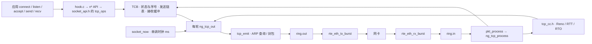
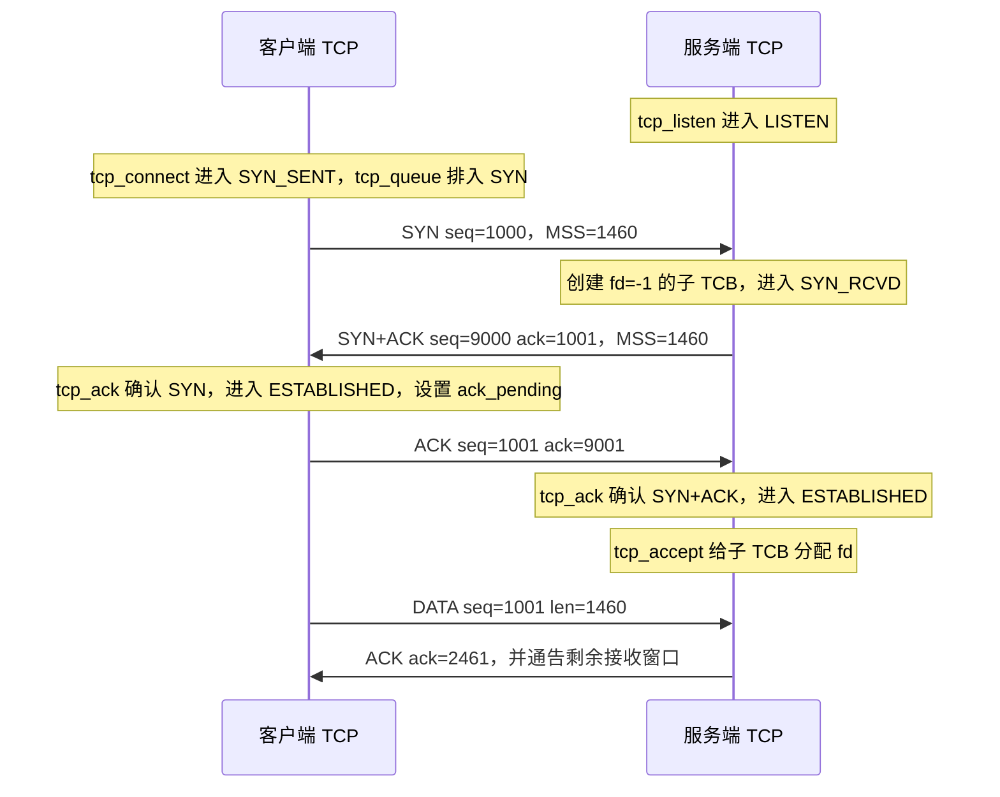
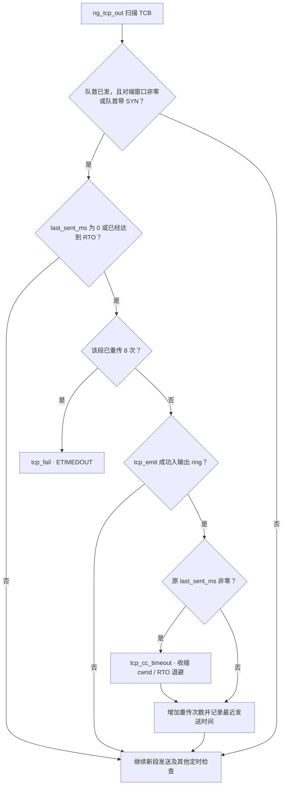

# DPDK 示例中的 TCP 建连、滑动窗口、拥塞控制与定时器

本文以当前工作区的 `examples/13_redis` 为主线，使用一条 IPv4 TCP 连接说明从 `connect()`、三次握手到首批数据、ACK 和丢包重传的代码路径。图使用 Mermaid。

## 1. 实现分层

| 机制 | 实现位置 | 职责 |
| --- | --- | --- |
| TCP 状态机与收发 | [tcp_core.h](../tcp_core.h)，`ng_tcp_process()`、`ng_tcp_out()` | 管理 TCB（连接控制块）、按四元组查找连接、处理握手和 ACK、驱动发送及重传 |
| 滑动窗口与流量控制 | [tcp_core.h](../tcp_core.h)，`tcp_ack()`、`ng_tcp_out()`、`tcp_recv()`、`tcp_emit()` | 维护发送序号、已确认边界、对端通告窗口、本地接收缓冲和窗口通告 |
| 慢启动与 Reno 拥塞控制 | [tcp_cc.h](../tcp_cc.h)，`tcp_cc_init()`、`tcp_cc_ack()`、`tcp_cc_dupack()`、`tcp_cc_timeout()` | 根据 ACK、重复 ACK 和超时调整 `cwnd` 与 `ssthresh` |
| TCP 定时检查 | [tcp_core.h](../tcp_core.h) 的 `ng_tcp_out()`、[socket_core.h](../socket_core.h) 的 `socket_now()`，以及 [tcp_cc.h](../tcp_cc.h) 的 `tcp_cc_rtt()` | 每轮读取单调时钟并检查连接或队首发送段的时间戳，计算和更新 RTO |
| DPDK 数据面 | [main.c](../main.c)，`rx_tx_loop()`、`pkt_process()` | 通过 ethdev burst 收发，使用 mbuf 承载报文、用 ring 交接报文 |

[DPDK 的 rte_tcp.h](../../../lib/librte_net/rte_tcp.h) 提供 TCP 头部结构和标志位。[08_tcp 示例](../../08_tcp/main.c) 也有被动握手和基本收发，使用 `ng_tcp_handle_listen()` / `ng_tcp_handle_syn_rcvd()` 推进状态，并在常见报文路径上通告固定 `TCP_INITIAL_WINDOW = 14600`。下文的动态窗口、Reno 与 RTO 属于 `13_redis` 的实现。

直接调用 `n*` 接口时从 `socket_api.h` 进入。应用操作与协议处理通过 `socket_state_lock` 保护 TCB 和队列。协议循环每轮先处理本批输入，再调用 `ng_tcp_out()`，随后检查 epoll 就绪。`tcp_emit()` 成功表示 mbuf 已进入 `ring.out`，发送序号和时间戳在这个边界更新。网卡 TX 由 I/O 循环随后完成。

## 2. 用一次三次握手串起来

假设客户端 C 和服务端 S 都走此示例的 TCP 路径，初始序号分别取 `1000`、`9000`，ARP 已解析，双方 MSS 为 1460，握手段无负载且没有丢包。序号是演示值，实际由 `tcp_new()` 生成。下文省略状态名前缀 `NG_TCP_STATUS_`。

1. **排入 SYN。** `tcp_connect()` 设置端点与 `SYN_SENT`，调用 `tcp_queue()`。`tcp_seg_end()` 计算段结束序号时给 SYN 和 FIN 各计一个序号，所以入队先把 `send_queued_end_seq` 推到 1001。`ng_tcp_out()` 成功输出该段后，才把 `send_next_seq` 推到 1001，并写入首次、最近发送时间。SYN 首发绕过数据发送的窗口检查。阻塞调用等待状态变化，非阻塞调用可返回 `EINPROGRESS`。
2. **生成 SYN+ACK。** `ng_tcp_process()` 校验报文，查找四元组及监听项。命中监听且 backlog 有余量时创建子 TCB，记录 `recv_next_seq = 1001`、对端通告窗口和 MSS，进入 `SYN_RCVD` 并将 SYN+ACK 入队。监听 TCB 继续处于 `LISTEN`。
3. **确认握手。** 客户端确认 SYN 已输出且收到的 `ack=1001` 匹配，执行 `tcp_ack()`，更新对端窗口和 `recv_next_seq=9001`，设置 `ack_pending` 并进入 `ESTABLISHED`。`ng_tcp_out()` 发出纯 ACK。服务端验证 `seq=1001`、`ack=9001` 且 SYN+ACK 已输出后推进状态。`tcp_accept()` 扫描归属该监听项的待接收子 TCB 并分配 fd。客户端可在最终 ACK 出队上网卡前观察到 `connect()` 成功。
4. **进入数据期。** 此时 C 侧 `SND.UNA = SND.NXT = 1001`，S 侧为 `9001`。若握手段从未重传，`tcp_ack()` 会在释放该段时采集 RTT 样本。SYN 占一个序号，因此这份实现也把握手 ACK 的 `acked_bytes=1` 传给慢启动逻辑，默认 MSS 下初始 `cwnd=14600` 会增至 `14601`。

## 3. 滑动窗口如何移动

| TCP 概念 | 对应字段 | 更新方式 |
| --- | --- | --- |
| `SND.UNA`，最早未确认序号 | `congestion.send_unacked_seq` | `tcp_ack()` 验证累计 ACK 后通过 `tcp_cc_ack()` 推进 |
| `SND.NXT`，下一发送序号 | `send_next_seq` | 新段成功进入输出 ring 时推进 |
| 已排队数据的结束序号 | `send_queued_end_seq` | `tcp_queue()` 预留，可能领先于 `SND.NXT` |
| 对端接收窗口 `rwnd` | `peer_recv_window` | 握手读取 TCP `rx_win`，数据期按 `last_window_update_seq/ack` 判定窗口更新的新旧 |
| `RCV.NXT`，期望收到的下一个序号 | `recv_next_seq` | 收到连续数据时增加实际接收字节数，接收 SYN / FIN 时消耗一个序号 |

- **发送侧。** `tcp_send()` 按当前 MSS 拆段，并受 1 MiB 应用发送队列容量限制。`ng_tcp_out()` 计算 `flight = SND.NXT - SND.UNA` 与 `W = min(cwnd, rwnd)`。新数据可用额度为 `max(0, W - flight)`。可用额度小于下一段负载时，代码拆分该段并把余量留在队列。`tcp_ack()` 释放完整确认的段，必要时裁剪队首已确认前缀。序号比较使用 `tcp_seq_before()/after()` 处理回绕。
- **接收侧。** `ng_tcp_process()` 丢弃超前的乱序段并安排累计 ACK。对有重叠的段跳过已收前缀，把连续的新数据放进 65,535 字节环形缓冲。`tcp_emit()` 通告 `65535 - recv_buffer_bytes`，握手只输出 MSS 选项。应用 `tcp_recv()` 消费数据后释放容量并设置 `ack_pending`，下一次 ACK 可通告更大的窗口。

例如 C 只发一个 1460 字节的段，`SND.NXT` 从 1001 到 2461，`flight` 从 0 到 1460。S 未消费时回 `ACK=2461, rwnd=64075`。C 收到后释放该段，`SND.UNA` 变为 2461，`flight` 回到 0。若 C 仍处于慢启动，`cwnd` 同时从 14601 增到 16061。S 的应用读走 1460 字节后，可以用相同的 `ACK=2461` 通告 `rwnd=65535`。这个窗口更新释放接收额度，ACK 序号无需再前进。

## 4. 慢启动和 Reno 拥塞控制

`cwnd` 表示发送端允许的在途额度，`rwnd` 反映对端缓冲空间。两者在 `ng_tcp_out()` 汇合，取较小值。以下是当前代码的 Reno 风格算术，参考 [RFC 5681](https://www.rfc-editor.org/rfc/rfc5681)。

| 事件 | 函数 | 当前代码的动作 |
| --- | --- | --- |
| 创建 TCB | `tcp_cc_init()` | `cwnd = 10 × MSS`，`ssthresh = 65535`，初始 RTO 1000 ms。初始 MSS 为 1460。`tcp_mss()` 可把 MSS 调小，未同步重算初始 cwnd |
| 新 ACK，`cwnd < ssthresh` | `tcp_cc_ack()` | `cwnd += min(新确认字节数, MSS)`。满窗口发送且每段收到一个 ACK 时，每个 RTT 的窗口大致翻倍 |
| 新 ACK，`cwnd >= ssthresh` | `tcp_cc_ack()` | 累计新确认字节，每累计达到当前 cwnd 增加一个 MSS。两种 ACK 增长路径最终都受 65535 字节上限约束 |
| 第 3 个符合条件的重复 ACK | `tcp_cc_dupack()` → `tcp_ack()` | `ssthresh = max(flight/2, 2×MSS)`，`cwnd = ssthresh + 3×MSS`，标记快恢复并把队首 `last_sent_ms` 置零，下一次输出轮询快速重传 |
| 快恢复期间 | `tcp_cc_dupack()` / `tcp_cc_ack()` | 后续重复 ACK 可继续增加 cwnd，首个推进 `SND.UNA` 的 ACK 把 cwnd 降为 ssthresh 并退出快恢复 |
| 队首 RTO 到期且重传成功入输出 ring | `tcp_cc_timeout()` | 重算 ssthresh，把 cwnd 降到 1 MSS，清理快恢复计数，RTO 翻倍并限制在 60 s |

数据期的重复 ACK 判定要求纯 ACK、窗口未变、`ack == SND.UNA` 且队首已发出。假设建连后首批数据的首段丢失，而后续三段到达 S，S 会分别安排相同的累计 ACK。若 C 收到三份满足条件的重复 ACK，就走快速重传。若有效重复 ACK 不足，队首超时后走 RTO 路径。`ack_pending` 是每连接的标记，同批输入中的多次 ACK 请求可以合并成一次输出。

## 5. 定时器由谁驱动

TCP 使用 `clock_gettime(CLOCK_MONOTONIC)` 转成毫秒。`pkt_process()` 即使该轮没有收到包，也会调用 `ng_tcp_out()` 扫描 TCB。RTO 检查使用最早未确认的已发队首段，推进 ACK 时会重置剩余已发队首的 `last_sent_ms`。首次发送保留 `first_sent_ms`，只对完整确认且未重传的段取样。

`tcp_cc_rtt()` 首次设置 `SRTT=样本`、`RTTVAR=样本/2`，之后对 SRTT 和 RTTVAR 分别用 1/8 和 1/4 的新样本权重更新。实现按毫秒取整，以 `SRTT + 4×RTTVAR` 计算 RTO，再夹到 1–60 秒。这里采用 RFC 6298 风格的估算。 [RFC 6298](https://www.rfc-editor.org/rfc/rfc6298)

**握手丢包例。** SYN 已成功入输出 ring，初始 RTO 为 1 秒。如果没有收到可接受的 SYN+ACK，轮询约 1 秒后尝试用原序号重传。成功入 ring 后，RTO 增到 2 秒，下一次约再等 2 秒，之后继续退避。服务端在 `SYN_RCVD` 收到重复 SYN 时，可以直接把 SYN+ACK 队首的 `last_sent_ms` 置零请求重传。半开状态另有超过 120 秒的超时检查，因此连接可能先触及总时限。ARP 未解析或输出入队失败时，代码会在后续轮询继续尝试，首次发送时间从首次成功入队起算。

| 其他时间检查 | 当前实现 |
| --- | --- |
| 零窗口探测 | 有待发或未确认队列且对端窗口为 0 时，按当前 RTO 间隔尝试发送 `seq=SND.NXT-1` 的空 ACK |
| Keepalive | 启用且处于 `ESTABLISHED`、发送队列为空时检查。默认空闲 300 秒，探测间隔 75 秒，探测上限 9 次 |
| 关闭与回收 | 无 fd 的 `TIME_WAIT` 到 60 秒后回收。无 fd 的 `FIN_WAIT_2` / `CLOSE_WAIT` 超过 120 秒后标记超时 |
| DPDK 定时器 | `main.c` 注册的 `rte_timer_reset(..., PERIODICAL, ..., arp_request_timer_cb, ...)` 驱动周期 ARP；I/O 循环在 `ENABLE_TIMER` 条件下调用 `rte_timer_manage()`。TCP 的扫描由协议循环独立驱动 |

## 6. 建议的源码阅读顺序

| 步骤 | 入口 |
| --- | --- |
| API 分发 | [hook.c](../hook.c) 的 `connect/listen/accept` → [socket_api.h](../socket_api.h) 的 `nconnect/nlisten/naccept` → `tcp_ops` |
| 握手 | [tcp_core.h](../tcp_core.h) 的 `tcp_new`（104）、`ng_tcp_process`（320）、`tcp_listen`（738）、`tcp_accept`（774）、`tcp_connect`（820） |
| 窗口与定时 | [tcp_core.h](../tcp_core.h) 的 `tcp_emit`（171）、`tcp_ack`（245）、`ng_tcp_out`（525）、`tcp_send`（873）、`tcp_recv`（934） |
| 拥塞算法 | [tcp_cc.h](../tcp_cc.h) 的 `tcp_cc_init`（22）、`tcp_cc_rtt`（32）、`tcp_cc_dupack`（56）、`tcp_cc_ack`（78）、`tcp_cc_timeout`（101） |
| 仓库测试入口 | [test_tcp_cc.c](../tests/test_tcp_cc.c) 验证序号回绕、窗口增长、快恢复和 RTO 算术。[test_tcp_core.c](../tests/test_tcp_core.c) 覆盖核心状态和收发路径 |

TCP 序号、握手与窗口术语可对照 [RFC 9293](https://www.rfc-editor.org/rfc/rfc9293)。
